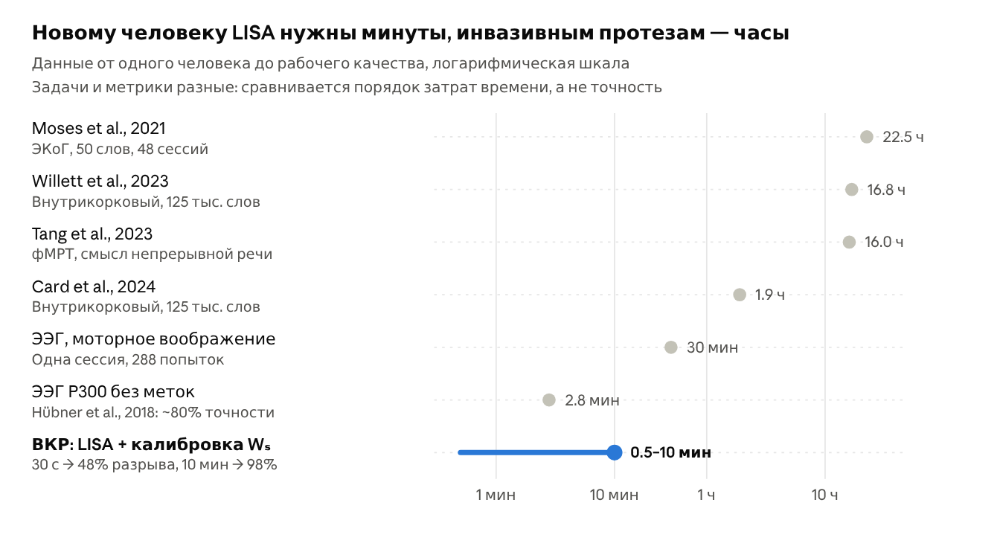
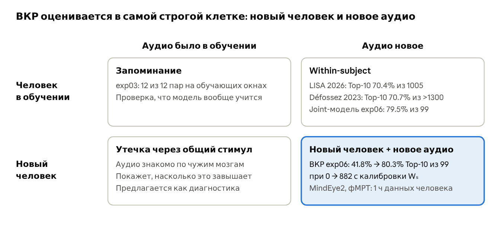
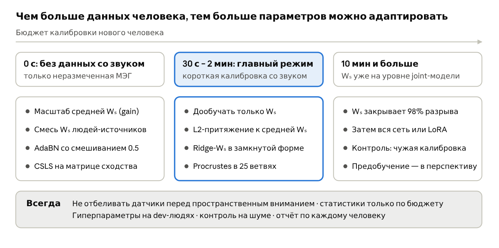
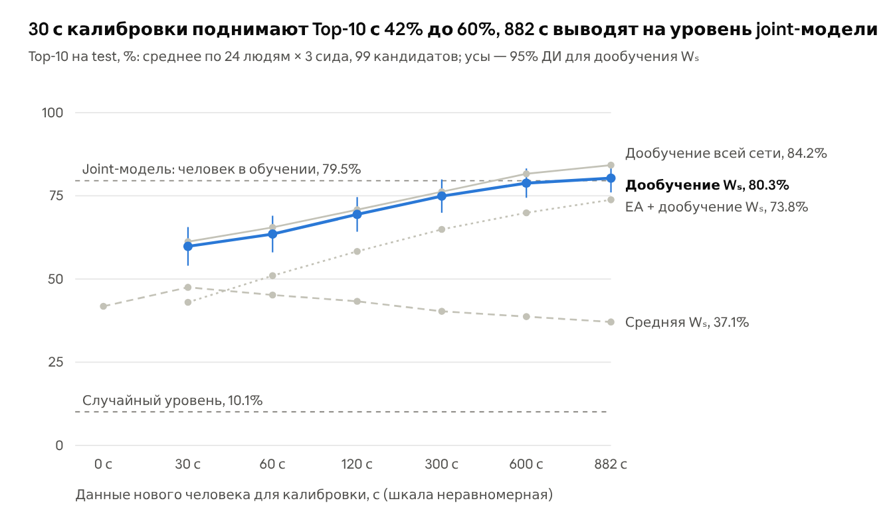

# Перенос МЭГ-декодера речи на нового человека — обзор и рецепты

7 октября 2026 · снимок [онлайн-документа](https://claude.ai/code/artifact/dfb97057-e5eb-4f2b-8165-741e32770e31); материалы ресёрча — в папке [`2026-10-07_cross_subject_transfer_review/`](2026-10-07_cross_subject_transfer_review/README.md)

## Резюме для питча

**Тезис одной фразой.** 10 минут пассивного прослушивания и 6750 обучаемых чисел переносят интерпретируемый МЭГ-декодер речи LISA на нового человека почти с качеством модели, в обучении которой он был (78.8% против 79.5% Top-10 среди 99; разница −0.7 п.п., 95% ДИ \[−2.4; +0.9\]). Уже 30 секунд закрывают половину разрыва.

**Проблема.** Неинвазивное декодирование воспринимаемой речи по МЭГ даёт около 70% Top-10 среди \~1000 сегментов, но только для людей из обучения. Индивидуальность хранится в своём входном слое, и у нового человека его нет. Foundation-модели этого не решили: их тоже дообучают на данных человека.

**Ниша.** В найденных работах нет кривой «качество против секунд калибровки» для retrieval речи по МЭГ. CPSD (2026) дообучает на 70% данных человека без оси бюджета, PNPL 2026 классифицирует слова на минутах. Вклад ВКР — не новый калибратор, а измерение на компактном интерпретируемом декодере в строгом протоколе. На питче говорить «в найденных работах нет», а не «впервые».

**Что уже показано (exp06).** Без калибровки — 41.8%, значимо выше случая у 24 из 24 человек. Дообучение одной Wₛ закрывает разрыв до joint-модели (одна модель на всех 27 людей, включая нового; 79.5%) в среднем на 48% за 30 с, 73% за 2 мин и 98% за 10 мин. Вся сеть добавляет лишь 1–4 п.п.; ранг 8 ≈ полная матрица (в пределах ±2 п.п.); Euclidean Alignment в нашей связке (без полосового фильтра, внимание по координатам датчиков) вредит. Слабый zero-shot частично объяснён: матрицы людей почти ортогональны, и их среднее схлопывается по норме; восстановление нормы даёт +10.6 п.п. (сид 0, правило ещё не подтверждено).

**Что дальше.** exp07 — калибровка без градиентов на замороженной модели; укрепление протокола (расширенный банк, контроли, lockbox); проверка, что после калибровки источники остаются слуховыми.

**Сюжет питча на \~10 минут:**

| # | Слайд | Главная мысль | Опора |
| --- | --- | --- | --- |
| 1 | Титул и тезис | Новый человек калибруется за минуты через одну матрицу 25×270 | 41.8% → 59.8% → 78.8% при 0 / 30 / 600 с |
| 2 | Декодер работает только на «своих» | У нового человека нет своего слоя, а время МЭГ дорого | Необученный слот = 10.2% (случай); CPSD: zero-shot выше случая у 21 из 47 |
| 3 | Зачем это сейчас | Неинвазивные декодеры заработали, МЭГ становится носимой, нейроданные регулируются | График «минуты против часов» из раздела ниже |
| 4 | Место в литературе | В найденных работах перенос для retrieval речи изучен без оси бюджета | Таблица с пулом и случайным уровнем в каждой строке |
| 5 | Модель и объект калибровки | Калибровка — это 6750 чисел Wₛ; остальная сеть общая | Схема LISA; у Défossez слои людей — \~2 млн параметров |
| 6 | Протокол | Самая строгая клетка: новый человек + новое аудио | Схема 2×2; LOSO, dev-люди, нормировка по бюджету, Холм |
| 7 | Главный результат | Кривая калибровки; при 882 с Wₛ догоняет joint-модель | +0.8 п.п. \[−1.1; +2.6\], лучше у 15 из 24 |
| 8 | Что калибровать | При малом бюджете вся сеть почти ничего не добавляет (её lr на краю сетки — оценка снизу) | Вся сеть − Wₛ: +1.4 (30 с, p = 0.30) … +3.9 (882 с) |
| 9 | Индивидуальные различия (запасной) | Результат калибровки определяется уровнем человека в joint-модели | Zero-shot 18.5–78.8%; r(joint, результат за 30 с) = 0.84; связь прироста с zero-shot — в основном регрессия к среднему |
| 10 | EA вредит | Стандарт из ЭЭГ не переносится на нашу связку | −16.8 п.п. при 30 с; четыре гипотезы и лестница абляций |
| 11 | Почему слаб zero-shot и план exp07 | Средняя Wₛ в 3.8 раза «тише»; чиним без градиентов | Косинус 0.03; восстановление нормы 40.0% → 50.6% (модели сида 0) |
| 12 | Вклад и план | Пассивная калибровка, 6750 чисел на человека, перенос на OPM | Октябрь — exp07; ноябрь — абляции EA; декабрь–январь — интерпретируемость; февраль–март — ses-1 |

## Задача и зачем она нужна

Неинвазивные декодеры речи вышли в ведущие журналы, но у всех них есть слой отдельного человека, а у нового человека его нет. Вопрос ВКР — сколько секунд записи нужно новому человеку и можно ли обойтись без дообучения. Он стал практическим: МЭГ становится носимой, а закон требует собирать минимум нейроданных.

*аудит объёмов данных OVMI (2026), статьи авторов, протокол BCI IV 2a; ВКР — exp06*

Инвазивные протезы требуют часов данных и активных попыток речи, плюс периодические доборы из-за дрейфа. Калибровка LISA пассивна: человек просто слушает, а «разметка» бесплатна, потому что системе известно, какой звук играл. Источники точек: [Card et al., 2024, NEJM](https://doi.org/10.1056/NEJMoa2314132), [Willett et al., 2023, Nature](https://doi.org/10.1038/s41586-023-06377-x), [Tang et al., 2023, Nat Neurosci](https://doi.org/10.1038/s41593-023-01304-9), [Hübner et al., 2018](https://doi.org/10.1109/MCI.2018.2807039), сводка объёмов — [OVMI, 2026](https://github.com/neural-processing-lab/OVMI).

**Почему сейчас — три причины:**

1. **Неинвазивные декодеры заработали.** Défossez et al., 2023 (Nature Machine Intelligence) — до 41% Top-1 среди 1000+ сегментов по 3 с МЭГ. Brain2Qwerty (препринт 2025, журнальная версия — Nature Neuroscience, 2026) — CER 32% по МЭГ против 67% по ЭЭГ. И там, и там есть subject-слой.
2. **МЭГ становится носимой.** OPM-шлемы без сверхпроводимости ([Boto et al., 2018, Nature](https://doi.org/10.1038/nature26147)) выпускают несколько компаний. Число и положение датчиков там меняются от человека к человеку, так что перенос становится обязательным.
3. **Нейроданные стали юридически чувствительными.** [Рекомендация ЮНЕСКО по этике нейротехнологий](https://www.unesco.org/en/legal-affairs/recommendation-ethics-neurotechnology) (ноябрь 2025), законы Колорадо (2024), Калифорнии (2024), Монтаны (2025) и Коннектикута (2026), Чили (2021). Десять минут записи и 6750 параметров на человека — аргумент минимизации данных.

**Честная рамка применения.** Декодирование воспринимаемой речи — ещё не интерфейс для общения. Его ближайшие применения: объективная оценка понимания речи у тех, кто не может ответить (афазия, нарушения сознания, младенцы в OPM-шлеме), аудиология, нейромаркеры отслеживания речи. Методика калибровки переносится на декодеры намеренной речи: у Brain2Qwerty тоже есть subject-слой.

## Ландшафт декодирования речи по МЭГ/ЭЭГ

Базовый рецепт с 2023 года не поменялся: контрастное обучение «МЭГ ↔ эмбеддинг wav2vec 2.0» и линейный subject-слой на входе. На MEG-MASC это даёт около 70% Top-10 среди \~1000 кандидатов, но только когда все люди есть в обучении. Перенос на нового человека стал отдельной темой только в 2026 году, и опубликованной кривой «качество против секунд калибровки» для retrieval речи по МЭГ не найдено. Это ниша ВКР.

| Работа | Задача и метод | Данные | Результат (метрика, пул кандидатов) | Новый человек |
| --- | --- | --- | --- | --- |
| [CPSD, Zhang et al., 2026](https://arxiv.org/abs/2608.22420) | Retrieval речи; subject-слой нового человека инициализируется CorrCA-средним источников и дообучается | Armeni (МЭГ, 3 чел.), два ЭЭГ-набора | Top-10 61.3% из 1024 против 63.0% у multi-subject; zero-shot выше случайного у 21 из 47 человек | Да, но дообучение на \~70% данных, без кривой бюджета |
| [PNPL 2026 и LibriBrain100](https://arxiv.org/abs/2609.03231) | Классификация 50 слов; трек Broad — перенос на новых людей | \~80 ч одного человека + 32 человека по \~40 мин | Balanced Top-10 (случайно 20%); глубокий донор даёт другим людям около +15 п.п. | Да: бюджеты 40 / 20 / 10 мин и zero-shot |
| [LISA, Semenkov et al., 2026](https://arxiv.org/abs/2608.01481) | Retrieval 3 с → wav2vec 2.0; 487 тыс. параметров, интерпретируемый вход | MEG-MASC, 27 чел. | Top-1 39.75%, Top-10 70.40% из 1005 | Нет, все люди в обучении |
| [Défossez et al., 2023, Nat Mach Intell](https://www.nature.com/articles/s42256-023-00714-5) | Retrieval 3 с → wav2vec 2.0; пространственное внимание + subject-слой | 4 датасета, 175 чел. | Top-1 41.3%, Top-10 70.7% среди >1300 сегментов (MEG-MASC); на ЭЭГ заметно хуже | Нет |
| [The Brain’s Bitter Lesson, Jayalath et al., ICML 2025](https://arxiv.org/abs/2406.04328) | Self-supervised предобучение МЭГ-энкодера | \~400 ч, \~900 чел. | +15–27% к прошлым SSL-методам; лог-линейный рост с объёмом данных | Да: рост качества и на отложенных людях |
| [MEG-XL, Jayalath & Parker Jones, 2026](https://arxiv.org/abs/2602.02494) | Предобучение с контекстом 2.5 мин; датчики кодируются координатами, без subject-слоя | \~300 ч, >800 чел. | Balanced Top-10 47.0% из 50 слов на MEG-MASC при 13% обучающих данных | Частично |
| [d’Ascoli et al., 2025, Nat Commun](https://www.nature.com/articles/s41467-025-65499-0) | Пословный retrieval, чтение и слушание | 9 датасетов, 723 чел. | До 37% balanced Top-10 из 250 слов; усреднение повторов повышает качество (≈×2, не перепроверено) | Нет |
| [SuLoRA, Klein et al., 2025](https://arxiv.org/abs/2510.08059) | Низкоранговый subject-слой вместо полного | MEG-MASC + ЭЭГ | Ранг 8 ≈ полный subject-слой при в 10 раз меньшем числе параметров (по аннотации) | Нет оценки на новых людях |
| [MEGFormer, Boyko et al., MICCAI 2024](https://doi.org/10.1007/978-3-031-72069-7_27) | CNN-Transformer вместо свёрточного энкодера Défossez (AIRI, Сколтех) | MOUS, Gwilliams | Точность 69% → 83% и 67% → 70%; метрика и пул не подтверждены | Нет |
| [Brain2Qwerty, Lévy et al., 2025–2026, Nat Neurosci](https://doi.org/10.1038/s41593-026-02303-2) | Продукция: декодирование печати | 35 чел. | CER 32% по МЭГ против 67% по ЭЭГ (препринт; журнальные 29% / 65% и версия 2 не перепроверены) | Нет |
| [LibriBrain, Özdogan et al., NeurIPS 2025](https://arxiv.org/abs/2506.02098) | Детекция речи, фонемы, слова | 52 ч, 1 чел. | Качество растёт логарифмически от 5 до 50 ч; соревнование — 155 команд | Нет |

Проценты в таблице нельзя сравнивать напрямую: пул кандидатов меняется от 50 до 1363, окна и разбиения разные. В exp06 пул — 99 кандидатов при случайном уровне 10.1%.

**Волна аудитов 2024–2026.** Часть прироста в литературе оказалась шорткатами (цифры ниже — по препринтам 2026 года). Гауссов шум без мозгового сигнала даёт 66.3% R@1 при окнах переменной длины ([Zhang et al., 2026](https://arxiv.org/abs/2605.24524)). На LibriBrain100 синтетические сигналы с одним таймингом и реальная МЭГ дают 22.0% против 22.3% balanced accuracy ([Jayalath & Parker Jones, 2026](https://arxiv.org/abs/2609.40359)). Протокол ВКР с фиксированными 3-секундными окнами от этих ловушек защищён лучше, но контроль на шуме стоит добавить (см. раздел об оценке).

**Контекст.** Инвазивные речевые интерфейсы далеко впереди (Card et al., 2024, NEJM: 97.5% точности за 8.4 месяца), но требуют операции. В фМРТ общая модель со своим линейным входом на человека, дообученная на 1 ч данных нового человека, даёт 79% Top-1 retrieval против 99% при 40 ч ([MindEye2, ICML 2024](https://arxiv.org/abs/2403.11207)). У ВКР речь идёт о минутах МЭГ.

**Родословная LISA.** LISA продолжает линию лаборатории А. Осадчего (ВШЭ): компактная сеть из ветвей «пространственный фильтр + временной фильтр» с пересчётом весов в паттерны ([Petrosyan et al., 2021, J Neural Eng](https://doi.org/10.1088/1741-2552/abe20e)) → BEIRA (ЭЭГ → фМРТ, 2022) → LISA (МЭГ-речь, 2026). Теория интерпретации — [Haufe et al., 2014, NeuroImage](https://doi.org/10.1016/j.neuroimage.2013.10.067): читать нужно паттерны, а не веса. Независимый МЭГ-аналог — LF-CNN ([Zubarev et al., 2019, NeuroImage](https://doi.org/10.1016/j.neuroimage.2019.04.068)). Отсюда дешёвый и сильный анализ для ВКР: пересчитать Wₛ нового человека в паттерны и проверить, что после калибровки источники остаются слуховыми.

**Работы научрука и соавторов LISA, которые полезно знать к питчу:** оценка ритмов с низкой задержкой ([Semenkov et al., 2023](https://doi.org/10.1088/1741-2552/acf7f3)), ReDisCA ([Ossadtchi et al., 2024](https://doi.org/10.1016/j.neuroimage.2024.120868)), CD-PSIICOS ([Kleeva & Ossadtchi, 2025](https://doi.org/10.1016/j.neuroimage.2025.121268)), картирование речи по ЭКоГ с проверкой на новых пациентах ([Voskoboynikov et al., 2025](https://doi.org/10.1088/1741-2552/adfc9c)). Ожидаемые вопросы из этой лаборатории — про обработку сигнала (фильтрация перед EA), обратную задачу и пересчёт к общему положению головы. Других российских работ по межсубъектному декодированию речи, кроме MEGFormer (AIRI и Сколтех), найти не удалось — стоит уточнить у научрука.

**Соседняя область — слуховая ЭЭГ.** Челленджи [ICASSP Auditory EEG 2023/2024](https://github.com/exporl/auditory-eeg-challenge-2024-code) (KU Leuven) решают match-mismatch для непрерывной речи — тот же retrieval, но среди 2–9 кандидатов. Модель VLAAI ([Accou et al., 2022](https://doi.org/10.1101/2022.09.28.509945)) обучена на 80 людях (144 ч ЭЭГ) вообще без слоя на человека. В МЭГ-речи такого масштаба по людям нет, поэтому калибровка по секундам здесь важнее.

## Выравнивание данных между людьми

Литература 2024–2026 годов в основном указывает на одно: выравнивать сырые датчики (EA, рецентрация) полезно для небольших ЭЭГ-сетей, но для контрастных retrieval-декодеров и моделей со своим слоем на человека это бесполезно или вредно. Лучше работает выравнивание в латентном пространстве и по общему стимулу. Провал EA в exp06 (−6…−17 п.п.) согласуется с этой картиной, но может объясняться и нашей предобработкой — см. гипотезы ниже.

**Три семейства методов:**

1. **Ковариационное выравнивание входа** — EA, римановская рецентрация, RPA. Стандарт для моторного воображения на 22 каналах ЭЭГ.
2. **Латентное выравнивание** — AdaBN, Latent Alignment, доменная BN на SPD-матрицах. Выравнивает статистики внутри сети, после пространственных фильтров.
3. **Функциональное выравнивание по общему стимулу** — hyperalignment, SRM, MCCA, ridge-«конвертеры». Требует, чтобы люди получали один и тот же стимул. В MEG-MASC это так: все 27 человек слушали одни и те же истории.

| Работа | Что выравнивает | Результат | Что значит для LISA |
| --- | --- | --- | --- |
| [Junqueira et al., 2024, J Neural Eng](https://doi.org/10.1088/1741-2552/ad4f18) | EA перед общей глубокой сетью, ЭЭГ моторного воображения | +4.33 п.п. на новом человеке при EA по 24 испытаниям; +5.55 п.п. по всем данным | Главный аргумент «за EA», но условия другие: ЭЭГ моторного воображения с десятками каналов, классификация, нет своего слоя на человека |
| [Wu et al., 2022, Neural Networks](https://doi.org/10.1016/j.neunet.2022.06.008); [Wu, 2025, J Neural Eng](https://arxiv.org/abs/2502.09203) | EA в полном конвейере переноса (27 комбинаций); ревизия EA через 5 лет | EA даёт +1.1…+13.5 п.п. только в связке с переносом и после полосы 8–30 Гц; без переноса — −0.06…−0.12 п.п. Ревизия 2025 советует ставить фильтрацию перед EA | В exp06 полосового фильтра перед EA нет, ковариация нецентрированная |
| [ProCA, Zhou et al., 2026, препринт](https://arxiv.org/abs/2609.05094) | EA перед контрастным ЭЭГ→изображение декодером, LOSO | По одной таблице препринта EA снижает Top-1 (20.1% → 15.2% при 200 кандидатах); цифры не перепроверены | Одно из немногих независимых свидетельств вреда EA для retrieval |
| [Lopes et al., 2026, препринт](https://arxiv.org/abs/2606.16462) | Свой энкодер на человека против EA | Свой энкодер «поглощает» роль EA; низкоранговый адаптер не уступает полному на пяти архитектурах | Совпадает с exp06: при своей Wₛ EA избыточна, ранг 8 ≈ полная Wₛ |
| [Bakas et al., 2025, J Neural Eng](https://arxiv.org/abs/2311.17968) | Статистики на нескольких слоях (Latent Alignment) против EA и AdaBN | Эффект EA затухает с глубиной; AdaBN и LA держат выравнивание до выхода | Обоснование AdaBN и выравнивания 25 ветвей в exp07 |
| [Kobler et al., NeurIPS 2022](https://arxiv.org/abs/2206.01323) | Доменная BN на ковариациях после обучаемых фильтров | Рецентрация и масштабирование ковариаций после обучаемых фильтров; модель остаётся интерпретируемой | Аналог для LISA: рецентрация ковариации 25×25 ветвей (325 параметров вместо 21 736) |
| [Mellot et al., 2023, Imaging Neurosci](https://doi.org/10.1162/imag_a_00040) | Римановская рецентрация МЭГ (Cam-CAN): новые люди в новой задаче | δR² +0.096 и +0.045; без понижения ранга после чистки артефактов SPD-методы неприменимы | Перед ковариационным выравниванием 208 каналов после ICA нужен учёт ранга |
| [Haxby et al., 2011, Neuron](https://doi.org/10.1016/j.neuron.2011.08.026); [Chen et al., NIPS 2015 (SRM)](https://papers.nips.cc/paper/5855-a-reduced-dimension-fmri-shared-response-model) | Ортогональные Procrustes-отображения в общее пространство по общему стимулу | Межсубъектный классификатор на уровне внутрисубъектного | Теория для Procrustes-калибратора exp07 |
| [Bazeille et al., 2021, NeuroImage](https://doi.org/10.1016/j.neuroimage.2021.118683) | Бенчмарк функционального выравнивания, 4 фМРТ-датасета | Лучшие методы — SRM и оптимальный транспорт; кусочное выравнивание дешевле и лучше searchlight | Ориентир, какие методы функционального выравнивания пробовать первыми |
| Zhang et al., 2017, Human Brain Mapping; [de Cheveigné et al., 2019, NeuroImage](https://doi.org/10.1016/j.neuroimage.2018.11.026) | M-CCA для МЭГ: общее пространство без локализации источников | На МЭГ лучше соответствия датчиков и локализации источников | Ближайший МЭГ-аналог функционального выравнивания |
| [Tang & Huth, 2025, Current Biology](https://doi.org/10.1016/j.cub.2025.01.024) | Линейные «конвертеры» фМРТ между людьми, 7 участников | Декодер опорного человека работает на новом после выравнивания; конвертер можно обучить даже на немом кино | Калибровочный стимул может отличаться от целевого |
| [Thual et al., 2023/TMLR 2025](https://arxiv.org/abs/2312.06467) | Функциональное выравнивание (FUGW) нового человека на референсного | До +75% к анатомическому выравниванию; выигрыш над моделью одного человека, пока данных меньше 100 мин | Готовая метрика «эквивалентного бюджета» |

**Почему EA вредит в LISA — четыре проверяемые гипотезы:**

1. Ковариация считается по нецентрированным окнам без полосового фильтра, поэтому отбеливание настраивается на медленные дрейфы, а не на полосу речи.
2. ICA отбрасывает от 2 до 8 компонент, причём разные для двух историй; при shrinkage 1e-2 «вырезанные» направления усиливаются примерно в 10 раз.
3. Отбеливание смешивает каналы, а пространственное внимание LISA параметризовано координатами датчиков.
4. У каждого человека уже есть своя Wₛ, и линейное преобразование входа она поглощает сама.

Каждая гипотеза проверяется отдельной абляцией на трёх dev-людях. Механизм вреда пока не доказан, поэтому на питче его стоит называть гипотезой.

**Что проверить вместо EA (без меток и без переобучения сети):**

- Отображение к средней ковариации источников, а не к единичной: «перекрашивание» x′ = C̄¹ᐟ²·C⁻¹ᐟ²·x или STMA в режиме «spatio» ([Gnassounou et al., 2024](https://arxiv.org/abs/2407.14303)). Масштаб, на который обучена сеть, при этом сохраняется.
- Выравнивание спектра каждого канала без смешивания каналов — CMMN ([Gnassounou et al., NeurIPS 2023](https://arxiv.org/abs/2305.18831)). Совместимо с вниманием по координатам датчиков.
- Пересчёт к общему положению головы по файлам MRK/ELP/HSP из MEG-MASC: ft\_megrealign в FieldTrip (Knösche, 2002) или SSS с параметром destination в MNE ([Taulu & Kajola, 2005](https://doi.org/10.1063/1.1935742)). Корректность SSS для KIT-системы не проверена.
- Римановская рецентрация и поворот в касательном пространстве ([Bleuzé et al., 2022](https://doi.org/10.3389/fnhum.2022.1049985); pyRiemann) — в пространстве 25 ветвей, где ковариация всего 25×25.
- Безметочный выбор гиперпараметров ([SKADA-Bench](https://arxiv.org/abs/2407.11676)) как дополнение к подбору на трёх dev-людях.

## Субъект-специфичные слои, PEFT и few-shot

Работы из инвазивных BCI, фМРТ и ЭЭГ сходятся в том, что отдельный входной слой на человека нужен. Что при малом бюджете достаточно адаптировать только его, прямо показывают POYO и exp06; MindEye2 и BrainGate дообучают и общую сеть. Дообучение всей сети прибавляет немного и в основном от десятков минут данных. Это та же картина, что в exp06: Wₛ выходит на потолок, вся сеть даёт +1–4 п.п.

| Работа | Что адаптируют | Результат | Связь с ВКР |
| --- | --- | --- | --- |
| [POYO, NeurIPS 2023](https://arxiv.org/abs/2310.16046); POYO+, ICLR 2025 | Только эмбеддинги нейронов и сессии, сеть заморожена | Та же обезьяна: R² 0.9675 против 0.9682 у модели с нуля и 0.9708 при полном дообучении. Новая обезьяна: одних эмбеддингов заметно меньше (0.9012 против 0.9379) | Инвазивный аналог «Wₛ до потолка, вся сеть — чуть выше» |
| [Cross-brain transfer of intracortical speech BCIs, 2026, препринт](https://www.biorxiv.org/content/10.64898/2026.01.12.699110v1) | Аффинные входные слои на пользователя, 5 пользователей BrainGate2 | Перенос помогает, пока у нового человека меньше \~200 предложений; без входных слоёв проваливается | Входные слои на человека обязательны для переноса (там они обучались вместе с общей сетью) |
| [MindEye2, ICML 2024](https://arxiv.org/abs/2403.11207) | Ridge-вход на человека + общая сеть; при дообучении меняется вся сеть | 1 ч данных: Top-1 retrieval 79.0% против 98.8% при 40 ч, среди 300 изображений | Эталон «малых данных» в фМРТ — час; у ВКР — минуты |
| [Csaky et al., 2023, Human Brain Mapping](https://doi.org/10.1002/hbm.26500) | Эмбеддинги людей в групповой МЭГ-модели, 15 чел. | Эмбеддинги +24% нелинейной модели; дообучение помогает всем, сильнее — сильным людям | Проверить, кому в exp06 помогает дообучение всей сети |
| [NDT3, 2025, bioRxiv](https://www.biorxiv.org/content/10.1101/2025.02.02.634313v1) | Предобучение на \~200–2000 ч инвазивных записей | Предобучение выигрывает, пока у новой задачи меньше \~1.5 ч данных (по аннотации) | Порог полезности общей модели |
| [Lopes et al., 2026, препринт](https://arxiv.org/abs/2606.16462) | Выбор энкодера-источника по калибровке; низкоранговый адаптер | Низкоранговый адаптер на человека не уступает полному энкодеру; узкое место — выбор источника для нового человека | Аналог select\_ws из exp07 и «ранг 8 ≈ полная Wₛ» |
| [Tao & Chen, 2026, код и статья](https://github.com/gaivrt/eeg-personal-population-benefit) | Свой адаптер против чужих, 3 ЭЭГ foundation-модели, 235 новых людей | Свой адаптер +1.5–5.4 п.п. к популяционной модели и +2.3–7.3 п.п. к чужим адаптерам; калибровка по нескольким меткам устойчивого выигрыша не дала | Готовый контроль: часть прироста может быть не персональной |
| [TGBD, 2024, препринт](https://arxiv.org/abs/2410.14445) | Без модулей на человека, zero-shot против числа людей (фМРТ) | Top-1 среди 100: 2% при 1 человеке в обучении, 45% при 167 (по аннотации) | При 27 людях zero-shot ограничен, калибровка выгоднее |
| [BraInCoRL, NeurIPS 2025](https://arxiv.org/abs/2505.15813); BrainCoDec, CVPR 2026 | In-context мета-обучение: параметры человека за один прямой проход | 100–200 изображений нового человека близки к модели на \~9000 (фМРТ) | Идея гиперсети для Wₛ; при 26 людях риск переобучения |
| [MEG-GPT, 2025–2026, Imaging Neurosci](https://arxiv.org/abs/2510.18080) | Self-supervised МЭГ-модель, 612 человек Cam-CAN | Новый человек zero-shot: точность 0.41 → 0.49; проверено на одном человеке | Zero-shot в МЭГ пока слаб |
| [MAML для ЭЭГ, 2021](https://arxiv.org/abs/2103.08664) и контрпримеры 2024 | Мета-обученная инициализация | Выигрыш непостоянен; работа 2024 года рекомендует обычный перенос вместо MAML | Reptile-инициализация Wₛ — дешёвый, но скромный эксперимент |

**Лестница по бюджету, собранная из литературы:**

1. **0–30 с, без градиентов.** Банк Wₛ источников: выбор лучшей, смесь с весами по калибровке, масштаб средней матрицы, AdaBN. Отдельно — ridge-оценка Wₛ в замкнутой форме к средней реакции людей на то же аудио и «eigen-subjects»: W = W̄ + ΣαₖUₖ по главным компонентам 26 матриц (классика адаптации к диктору в ASR). При почти ортогональных матрицах людей (косинус 0.03) выигрыш неочевиден — сначала стоит посмотреть спектр PCA.
2. **30 с – 2 мин.** Дообучать только Wₛ от средней (или CorrCA-средней, как в CPSD), с ранней остановкой или L2-притяжением к средней. Регуляризация и число шагов — только на dev-людях.
3. **От 5–10 мин.** После сходимости Wₛ размораживать сеть с малым LR или добавлять LoRA в декодер. Выигрыш проверять контролем «та же процедура на данных другого человека».

**Что это даёт питчу.** Формулировка для слайда: «вход — главное, всё остальное — после \~10 минут». Дообучение всей сети при 882 с (84.2%) выше потолка 79.5%: значит, потолок — это обычная совместная модель, а не верхняя граница, и часть прироста может быть не персональной. Это закрывается контролем с чужой калибровкой, как у Tao & Chen.

**Классика, которую стоит назвать самому.** Ансамбль и выбор пространственных фильтров из базы людей без обучения давно известны в ЭЭГ моторного воображения: пул источников CCSP разобран в туториале Wu et al., 2022 (часто цитируют также Krauledat 2008 и Fazli 2009 — не перепроверены). Стягивание к источникам — RCSP (Lu et al., 2010) и MDWM в pyRiemann. Регуляризация к стартовой точке — [L2-SP (Li et al., ICML 2018)](https://arxiv.org/abs/1802.01483). Поэтому новизна exp07 не в самих идеях, а в их переносе на контрастный retrieval речи по МЭГ и сравнении на одной оси бюджета.

## Foundation models, test-time adaptation и адаптация без меток

К октябрю 2026 года foundation-модели не решили задачу нового человека в МЭГ-речи. Лучшая МЭГ-модель MEG-XL всё равно дообучается на размеченных данных человека, а её же авторы в конкурсе PNPL 2026 задают 10–40 минут калибровки. Для адаптации без меток надёжнее методы без градиентов; градиентная TTA (Tent, SHOT) на замороженных нейромоделях часто вредит.

| Работа | Что показала | Вывод для ВКР |
| --- | --- | --- |
| [MEG-XL, ICML 2026](https://arxiv.org/abs/2602.02494) | Предобучение на \~300 ч МЭГ; 47.0–57.3% balanced Top-10 из 50 слов при 13% данных; без дообучения не работает | Веса открыты — возможный внешний бейзлайн на тех же бюджетах (нужен GPU от 80 ГБ) |
| [BrainOmni, NeurIPS 2025](https://arxiv.org/abs/2505.18185) | Общая модель ЭЭГ + МЭГ (656 ч МЭГ), сенсоры кодируются 3D-координатами; задачи — диагнозы и состояния, не речь | Принцип «вход по координатам датчиков» тот же, что у LISA |
| [MEG-GPT, 2025–2026](https://arxiv.org/abs/2510.18080) | Новый человек zero-shot: 0.41 → 0.49 на 4 классах, но только один человек и зрительная задача | Надёжного переноса без калибровки в МЭГ нет |
| [Are EEG Foundation Models Worth It?, ICLR 2026](https://openreview.net/forum?id=5Xwm8e6vbh) | При малых данных foundation-модели редко значимо лучше компактных сетей и классических декодеров; линейный пробинг слаб | Аргумент за компактную LISA + калибровку Wₛ |
| [EEG-FM-Bench, 2025](https://arxiv.org/abs/2508.17742) | Перенос с замороженным backbone часто ограничен; масштаб модели не гарантирует качества | Лёгкая адаптация обязательна |
| [The Identity Trap, 2026](https://arxiv.org/abs/2606.06647) | Доля дисперсии эмбеддингов, объясняемая человеком, 18.5–74.9% против 0.05–6.6% у метки задачи (README кода, 8 датасетов; первая версия — 4 клинических датасета ЭЭГ покоя) | Явная Wₛ в LISA изолирует личность, а не размазывает её по эмбеддингу |
| [EEG-Arena, 2026](https://arxiv.org/abs/2609.32743) | Контраргумент: предобучение лучше на большинстве из 57 задач, но выигрыш растёт с объёмом размеченных данных | Не относится к режиму секунд калибровки |
| [NeuroAdapt-Bench, MLHC 2026](https://arxiv.org/abs/2604.16926) | Tent −6.4 п.п., SHOT −6.5 п.п. на CBraMod; T3A без градиентов +2.2…+4.8 п.п. (по таблице препринта, не перепроверено) | Tent на LISA — только как негативный контроль |
| [Wimpff et al., 2024](https://arxiv.org/abs/2311.18520) | Кросс-субъект, BCI IV 2a: источник 57.38% → полная замена BN 64.32% → смешивание 0.5 + RA 65.59% (по таблице, не перепроверено) | Подтверждает AdaBN со смешиванием в exp07 |
| [SCORE, 2026](https://arxiv.org/abs/2608.19134) | ЭЭГ→изображение, LOSO, 200 кандидатов, Top-1: без адаптации 26.2% → CSLS 35.8% → полный метод 53.2%; EA — 27.5%, незначимо (строки 26.2% и 27.5% не перепроверены). На втором датасете выигрыш меньше: +3.1 п.п. | Самый близкий рецепт без меток для retrieval |
| [Tent, ICLR 2021](https://arxiv.org/abs/2006.10726); SAR, ICLR 2023; TTAB, ICML 2023 | Минимизация энтропии на тесте; ломается при малых батчах и смешанных сдвигах, гиперпараметры без меток почти не подобрать | У нового человека в LISA все факторы риска сразу |

**Что реалистично для замороженной LISA:**

- **AdaBN со смешиванием** статистик источника и нового человека (коэффициент около 0.5, подбор на dev). Вероятно, частично совпадёт с поправкой масштаба средней Wₛ, поэтому комбинацию стоит проверить явно.
- **Поправка на хабность** (CSLS, QB-Norm) на уровне матрицы сходства: ставится поверх любого калибратора, градиентов не нужно. Трансдуктивную версию (по всем 99 тестовым окнам) помечать отдельно.
- **Выравнивание распределения выходных эмбеддингов** нового человека к статистикам обучающих людей (центрирование и диагональная нормировка). Не требует звука, подходит для бюджета 0 с.
- **Procrustes без меток по псевдо-ориентирам** (взаимные ближайшие соседи) как пара к align\_procrustes со звуком. Работает, только если точность ориентиров заметно выше случайной — сначала её измерить.
- **Tent и SHOT** — только негативный контроль: 30 с — это всего 10 окон по 3 с, а энтропия по кандидатам легко схлопывается в «хабы».

**Зачем адаптация без меток, если звук известен?** В восприятии речи метки — это проигранное аудио, они почти бесплатны. Безметочные методы нужны для трёх случаев: поднять уровень без калибровки (41.8%), компенсировать дрейф во время использования и работать, когда синхронизация со звуком неизвестна. Этот вопрос на питче лучше закрыть самому.

**Размер против качества.** LISA — 487 тыс. параметров, новый человек — 6750 чисел Wₛ. Для сравнения: EEGPT — 10 млн, ST-EEGFormer — более 300 млн, NeuroLM — 1.7 млрд.

## Протоколы оценки и ловушки

В 2026 году утверждение «работает на новом человеке» требует одновременно отложенных людей, отложенных стимулов, контроля на шуме и статистики по людям. Протокол exp06 уже в самой строгой клетке. Оставшиеся риски: ICA по полной записи, правило масштаба Wₛ, найденное после просмотра test, банк из 99 кандидатов и неудачное слово «потолок».

*режимы оценки: люди × стимулы*

Цифры LISA и Défossez получены в правой верхней клетке, результаты ВКР — в правой нижней, поэтому сравнивать их напрямую нельзя.

**Случайный уровень у всех работ разный:**

| Работа | Метрика | Пул кандидатов | Случайный уровень | Режим |
| --- | --- | --- | --- | --- |
| ВКР, exp06 | Top-10 | 99 сегментов | 10.1% | Новый человек + новое аудио |
| LISA, 2026 | Top-10 | 1005 сегментов | 1.0% | Человек в обучении |
| Défossez, 2023 | Top-10 | Более 1300 сегментов | <1% | Человек в обучении |
| CPSD, 2026 | Top-10 | 1024 сегмента | \~1% | Новый человек, дообучение на 70% его данных |
| d’Ascoli, 2025 | Balanced Top-10 | 250 слов | 4% | Человек в обучении |
| MEG-XL, 2026 | Balanced Top-10 | 50 слов | 20% | Дообучение на человеке |

Для честного сравнения нужны метрики, не зависящие от пула. Нормированный ранг (случайно 0.5) у ВКР падает с 0.237 без калибровки до 0.069 при 882 с. Top-1 из 99 — это «топ-1%», как Top-10 из 1005: у ВКР 39.7% при 882 с. Плюс нужен расширенный банк из 1000+ кандидатов — аудио других историй, МЭГ для них не нужна.

**Работы, на которые опирается протокол:**

- [Kapoor & Narayanan, 2023, Patterns](https://doi.org/10.1016/j.patter.2023.100804) — утечки данных в 294 статьях из 17 областей, таксономия из 8 типов. В ВКР актуальны два: препроцессинг с доступом к тесту (ICA) и общий стимул у всех людей.
- [Li et al., 2021, IEEE TPAMI](https://doi.org/10.1109/TPAMI.2020.2973153) — высокая точность ЭЭГ-классификации держалась на блочном дизайне и медленных корреляциях; случайный кодбук работал не хуже.
- [Jo et al., 2024](https://arxiv.org/abs/2405.06459) — EEG-to-text на чистом шуме работает не хуже, чем на ЭЭГ; teacher forcing завышает метрики минимум втрое.
- [Varoquaux, 2018, NeuroImage](https://arxiv.org/abs/1706.07581) — при \~100 тестовых примерах ошибка оценки точности около ±10%. У ВКР 99 тестовых окон на человека, поэтому интервалы считаются по людям (n = 24).
- [Combrisson & Jerbi, 2015, J Neurosci Methods](https://doi.org/10.1016/j.jneumeth.2015.01.010) — значимость против случая считать по биномиальному порогу или перестановкам. Для Top-10 из 99 порог — 16 попаданий; средняя Wₛ без калибровки проходит его у 24 из 24 человек (у CPSD zero-shot значим у 21 из 47).
- [Gulrajani & Lopez-Paz, ICLR 2021](https://arxiv.org/abs/2007.01434) — результат метода переноса не определён без правила выбора гиперпараметров. Подбор на dev-людях — это их leave-one-domain-out.
- [Westfall et al., 2016, Wellcome Open Res](https://wellcomeopenresearch.org/articles/1-23) — если все люди оцениваются на одних 99 окнах, вывод верен для новых людей, но не для новой речи; стимулы нужно моделировать как случайный эффект.
- [Kriegeskorte et al., 2009, Nat Neurosci](https://doi.org/10.1038/nn.2303) — double dipping. Правило масштаба средней Wₛ найдено после просмотра test, поэтому финальная проверка — на нетронутом наборе.

**Два статистических уточнения к exp06.** Вывод «низкоранговая ≈ полная Wₛ» лучше доказывать тестом эквивалентности (TOST): 90% ДИ разности лежит в пределах ±2 п.п. на всех бюджетах, но при 300 с и больше низкоранговая систематически хуже примерно на 1 п.п. Минимальный различимый эффект при 24 людях — около 0.9–1.9 п.п. Разница «вся сеть − Wₛ» при 30 с (+1.4 п.п.) незначима после поправки Холма на 37 сравнений (p = 0.30), но без поправки p = 0.04. Это вопрос мощности, а не доказанное равенство.

**Чек-лист протокола:**

| Пункт | Статус в ВКР | Что сделать |
| --- | --- | --- |
| Сплит по фрагментам, общий для всех людей; test-аудио не участвует ни в обучении, ни в калибровке | Есть | — |
| Окна без перекрытия, буфер между train и test | Есть | — |
| Гиперпараметры только на dev-людях, одинаковая сетка на метод | Частично | Записать размеры сеток; добавить строку oracle |
| Всё, что зависит от нового человека, оценивается только по бюджету | Частично | ICA сейчас по полной записи — анализ чувствительности без ICA или с ICA по бюджету |
| Статистика по людям: ДИ, Wilcoxon + Holm, иерархический бутстрэп | Частично | Добавить TOST для утверждений «не хуже» и бутстрэп |
| Метрики, не зависящие от пула | Частично | Нормированный ранг уже посчитан (0.237 → 0.069); добавить MRR и расширенный банк 1000+ |
| Контроли на шорткаты | Частично | Есть только необученный слот; добавить шум или перемешанную МЭГ, ранжирование без МЭГ, банк внутри одной истории |
| Опорные уровни названы честно | Частично | Переименовать «потолок» в «joint-обучение»; добавить строку «только новый человек, с нуля» |
| Lockbox — набор, который не открывают до финала | Нет | ses-1 у 22 человек или третья история |
| Проверка между сессиями | Нет | Калибровка на ses-0 → тест на ses-1 |
| Результаты по каждому запросу и профиль по людям | Частично | Сохранять ранг каждого окна, показывать распределение выигрыша |

## Лучшие рецепты

Главный рецепт подтверждён и exp06, и литературой: при бюджете до нескольких минут адаптировать только входной слой человека, стартуя со средней матрицы и не трогая остальную сеть. Остальные рецепты улучшают края кривой: ноль секунд и десятки минут.

*рецепты по бюджету калибровки · сводка разделов выше*

| # | Рецепт | Доказательство | Когда работает |
| --- | --- | --- | --- |
| 1 | Калибровать только Wₛ от средней матрицы | exp06: 41.8% → 59.8% Top-10 за 30 с, 80.3% за 882 с. POYO: R² 0.9675 против 0.9682 у модели с нуля. exp06: вся сеть при 30 с даёт лишь +1.4 п.п. (p = 0.30) | Общая часть обучена на десятках людей; бюджет — минуты |
| 2 | Восстанавливать масштаб средней Wₛ | Диагностика exp06 (модели сида 0): 40.0% → 50.6% без данных человека | Матрицы людей почти ортогональны; множитель подбирать на dev, подтвердить на lockbox |
| 3 | Регуляризация к средней Wₛ (MAP), сила зависит от бюджета | Иерархическая модель у [Jayaram et al., 2016](https://doi.org/10.1109/MCI.2015.2501545); eigenvoice-адаптация к диктору в ASR по нескольким секундам речи (Kuhn et al., 2000) | Бюджет до 2 мин, когда свободная Wₛ переобучается |
| 4 | Функциональное выравнивание по общему стимулу: ridge или Procrustes к средней реакции группы | Tang & Huth 2025: декодер переносится между людьми через линейные конвертеры; Thual: до +75% к анатомическому выравниванию; hyperalignment: межсубъектный классификатор на уровне внутрисубъектного | Новый человек слушает тот же калибровочный стимул, что и источники |
| 5 | При малом бюджете ортогональное отображение вместо свободного | SCORE: Top-1 28.2% (ортогональное) против 20.0% (ridge) | 0–60 с; при большем бюджете свободная Wₛ выходит на joint-уровень |
| 6 | AdaBN со смешиванием статистик, а не полной заменой | Wimpff 2024 (числа таблицы, не перепроверены): 57.4% → 64.3% (замена) → 65.6% (смесь 0.5 + RA) | Неразмеченные окна нового человека; состав речи и тишины как в тесте |
| 7 | Поправка на хабность (CSLS) на матрице сходства | SCORE: CSLS даёт Top-1 35.8% без обучения (исходная строка 26.2% не перепроверена) | Retrieval; трансдуктивную версию помечать отдельно |
| 8 | Агрегировать соседние окна и повторы на тесте | d’Ascoli 2025: усреднение повторов заметно повышает качество (≈×2, не перепроверено); GCB: R@1 44% → 52% (препринт) | Группировка не должна раскрывать ответ; нужен контроль со случайной группировкой |
| 9 | Не отбеливать датчики (EA) перед координатным вниманием | exp06: −6…−17 п.п. на всех бюджетах; ProCA 2026 (препринт): EA снижает Top-1 retrieval-декодера; Lopes 2026: при своём слое на человека EA избыточна | Архитектуры Défossez и LISA; для EEGNet на 22 каналах EA, наоборот, помогает |
| 10 | Градиентная TTA (Tent, SHOT) — только негативный контроль | NeuroAdapt-Bench (препринт): −6.4 и −6.5 п.п.; SAR и TTAB: коллапс при малых батчах | Малые батчи, коррелированные окна — всё против TTA |
| 11 | Всю сеть — только после \~10 мин и с контролем «чужая калибровка» | exp06: +3.9 п.п. при 882 с; Tao & Chen 2026: часть прироста бывает не персональной | Десятки минут данных |
| 12 | Предобучение на чужой МЭГ — в перспективу | Brain’s Bitter Lesson: лог-линейный рост до 400 ч; MEG-XL: 47% при 13% данных | Сотни часов данных и GPU; выигрыш — не на секундах калибровки |

**Что добавить в exp07–exp08, по приоритету:**

- [ ] Контроли: шум или перемешанная МЭГ на замороженной модели, банк внутри одной истории, строка «только новый человек, с нуля»
- [ ] Нормированный ранг и расширенный банк 1000+ кандидатов, чтобы сравниться с LISA и CPSD
- [ ] Ridge-Wₛ в замкнутой форме и CorrCA-инициализация как новые калибраторы без градиентов
- [ ] CSLS поверх всех калибраторов, индуктивная и трансдуктивная версии
- [ ] MAP-калибровка Wₛ с L2 к средней, λ подобрана на dev-людях
- [ ] Контроль «чужая калибровка» для дообучения всей сети
- [ ] Лестница абляций EA на трёх dev-людях: полосовой фильтр, учёт ранга, EA после Wₛ
- [ ] Перенос между сессиями: калибровка на ses-0 → тест на ses-1, заодно lockbox
- [ ] Сохраняется ли интерпретируемость: паттерны ветвей нового человека против кластеров слуховых источников LISA
- [ ] Отображение к средней ковариации источников (STMA, CMMN) и пересчёт к общему положению головы как калибраторы без меток
- [ ] Повторить дообучение Wₛ на тех же строгих блоках, что в exp07: в exp06 блоки могли пересекать границы фрагментов

## Место работы: что уже показано

Дообучение одной пространственной матрицы Wₛ (25×270, 6.75 тыс. параметров) на 30 с данных нового человека поднимает Top-10 с 42% до 60%. На 882 с результат 80.3% — на уровне joint-модели (79.5%), в обучении которой участвует сам человек.

*experiments/exp06\_loso.md · LOSO на 27 людях MEG-MASC, 24 оцениваемых × 3 сида, RTX 3090*

**Пять результатов exp06, на которые опирается питч:**

1. Калибровка Wₛ лучше средней Wₛ у 23 из 24 человек уже при 30 с (+12.3 п.п., p<0.001 с поправкой Холма), при 882 с — у 24 из 24 (+43.2 п.п.).
2. Дообучение всей сети (около 311 тыс. обучаемых параметров: общая часть и своя Wₛ) добавляет к Wₛ лишь 1–4 п.п., значимо от 300 с. Это оценка снизу: lr для неё упёрся в верхний край сетки подбора (1e-4). Почти вся индивидуальность человека живёт во входном пространственном слое.
3. Низкоранговая поправка ранга 8 (2.4 тыс. параметров) значимо не отличается от полной Wₛ после поправки Холма ни при одном бюджете; при 300 с и больше она ниже примерно на 1 п.п.
4. Euclidean Alignment вредит: −6…−17 п.п. при всех бюджетах, при 30 с лучше ни у одного из 24 человек. Модели с EA хуже даже на людях из обучения: 66% против 78%.
5. Строгая нормировка (scaler только по окнам бюджета) стоит не больше 1.4 п.п. против scaler по всему пулу.

**Почему нулевой перенос занижен.** Матрицы разных людей почти ортогональны (средний косинус 0.03), поэтому средняя Wₛ в 3.8 раза «тише» матриц, на которых училась сеть. Восстановление нормы без данных нового человека поднимает Top-10 с 40.0% до 50.6% (диагностика на моделях сида 0; по трём сидам без калибровки — 41.8%). Правило найдено после просмотра test, поэтому exp07 проверяет его лишь исследовательски, а подтверждение будет на нетронутых данных (ses-1) (`gain_mean_ws`, множитель подбирается на dev-людях).

**Индивидуальные различия.** Без калибровки Top-10 у людей — от 18.5% до 78.8%. Результат за 30 с почти полностью определяется уровнем joint-модели для этого человека (r = 0.84) и положительно связан с уровнем без калибровки (r = 0.75). Отрицательная связь прироста с уровнем без калибровки (r = −0.52) — во многом регрессия к среднему: с поправкой Олдхэма r = −0.21. Медианная по людям доля закрытого разрыва — 0.50 / 0.75 / 0.90 / 0.99 при 30 / 120 / 300 / 600 с (по средним величинам — 48 / 73 / 88 / 98%). При 882 с Wₛ в среднем на 0.8 п.п. выше joint-модели (лучше у 15 из 24 человек), то есть на её уровне.

**Путь к этому результату:**

| Эксперимент | Что проверено | Итог |
| --- | --- | --- |
| exp07 | Калибровка без градиентов: AdaBN, выбор и ансамбль Wₛ, выравнивание ветвей (Procrustes) | Код и тесты готовы, прогон впереди |
| exp06 | LOSO на 27 людях: 7 калибраторов × 7 бюджетов | График выше |
| exp05 | mini-LOSO на 4 людях | Пилот калибровки Wₛ |
| exp04 | Небольшой baseline, 1 человек | Top-1 11.1%, Top-10 26.3% из 99 |
| exp03 | Пилот на реальных данных | Запоминание 12/12 пар |
| exp00 | Готовность LISA: код, smoke-прогон | 41 тест пройден |

**Ограничения, которые лучше назвать самому:** test взят из тех же двух историй, что и обучение; банк из 99 кандидатов не сравним напрямую с 1005 в статье LISA; гиперпараметры калибровки подобраны на 3 dev-людях.

## Риски и вопросы преподавателей

Самые вероятные атаки — новизна, утечка через общий стимул, пул 99 против 1005, «EA — это баг?» и слово «потолок». На каждую есть честный ответ и план проверки.

| Риск | Что сделать |
| --- | --- |
| Test уже много раз анализировался; правило нормы средней Wₛ найдено после просмотра test | Объявить exp07 исследовательской серией, фиксировать хеш протокола в git, подтверждать выводы на lockbox (ses-1 у 22 человек) |
| ICA посчитана по полной записи нового человека, включая test | Писать «бюджет после готовой ICA»; сделать анализ чувствительности без ICA или с ICA по бюджету |
| Банк из 99 кандидатов и двух историй — «лёгкая задача» | Расширить банк до 1000+ аудиосегментов; нормированный ранг и MRR; пул и случайный уровень на каждом слайде |
| Test — новые фрагменты тех же историй и синтетических голосов | Новая история в lockbox; в ограничениях прямо писать «новые фрагменты знакомых историй» |
| Гиперпараметры подобраны на трёх dev-людях | Добавить строку oracle и проверку leave-one-dev-out |
| «Потолок» превышен (84.2% против 79.5%) | Называть joint-моделью; добавить контроль «чужая калибровка» и строку «только новый человек, с нуля» |
| «EA вредит» прочитают как баг или как общий вывод про МЭГ | Ограничить формулировку связкой «EA + внимание по координатам + наша предобработка»; прогнать лестницу абляций |
| exp07 не даст выигрыша | Подать как информативный отрицательный результат; запасной трек — MAP/L2-SP и ridge-Wₛ |
| Мощности на 24 людях не хватает на различия меньше \~1–2 п.п. | Заранее объявить семейства сравнений; «равенство» — только через TOST; показывать профиль по людям |
| Retrieval держится на тишине и громкости | Контроли: перемешанная МЭГ, ранжирование без МЭГ, банк внутри одной истории |
| Часть внешних цифр не перепроверена по полному тексту | На слайды брать подтверждённые: Défossez 41.3 / 70.7, LISA 39.75 / 70.40, CPSD 61.3 / 63.0 и 21 из 47, Junqueira +4.33, Card 2024; остальное сверить перед питчем |

**Вопросы и короткие ответы:**

1. **Что нового, если subject-слой придумал Défossez, а CPSD уже переносит модель?** Метод не новый, новое — измерение: кривая 0–882 с в строгом LOSO, ответ «что калибровать», отрицательный результат EA и механизм слабого zero-shot. CPSD дообучает на 70% данных человека и кривой по бюджету не даёт.
2. **Не видела ли модель тестовое аудио через мозги других людей?** Нет: сплит по аудиофрагментам одинаков для всех 27 человек, test (lw1\_3, easy\_money\_6/7) не видела ни одна модель. Ограничение: это новые фрагменты тех же двух историй.
3. **У вас 99 кандидатов, у LISA 1005 — задача лёгкая?** Сравнивать в лоб нельзя. Top-1 из 99 — это «топ-1%», как Top-10 из 1005: у нас 39.7% при 882 с. Нормированный ранг падает с 0.237 до 0.069 (случай — 0.5); расширенный банк в плане.
4. **EA везде помогает — может, у вас баг?** Модель с EA хуже уже на людях из обучения (66.5% против 78.1%), так что дело не только в шуме оценки. Есть четыре проверяемые причины, и литература неоднозначна: EA помогает после полосовой фильтрации и в связке с переносом (Wu et al., 2022). Вывод ограничиваю нашей связкой.
5. **Модель с EA настраивали так же тщательно?** Тем же рецептом обучения, без отдельного подбора — это ограничение. Абляции EA пройдут с равным бюджетом подбора.
6. **Почему калибруете только Wₛ?** При 30–120 с вся сеть не значимо лучше; в абляции LISA удаление subject-слоя — самая большая потеря; при замороженной остальной сети ветви, вероятно, сохраняют смысл — это проверю пересчётом Wₛ в паттерны (см. ответ 15). Хранить на человека нужно 6750 чисел, а не около 311 тыс. (копия всей общей части).
7. **Вся сеть даёт 84.2% — больше «потолка». Что тогда потолок?** Слово неудачное: это joint-модель на 27 людей, не персонализированная. Wₛ выходит на её уровень без значимой разницы (эквивалентность в ±2 п.п. пока не доказана) (+0.8 п.п. \[−1.1; +2.6\]), а вся сеть — уже персонализация; часть прироста может быть не личной, что проверит контроль с чужой калибровкой.
8. **24 человека — это мало.** Единица вывода — человек, а не 72 прогона; интервалы и Wilcoxon + Холм считаются по людям; иерархический бутстрэп и TOST добавлю для проверки. Крупные эффекты устойчивы (23 из 24 при 30 с), а «равенство» нужно доказывать тестом эквивалентности, а не незначимым p.
9. **Не переобучились ли вы на выбор гиперпараметров?** Подбор — только на dev-людях по validation, перенос шагов между бюджетами — заранее объявленное правило. Для Wₛ этот риск работает против метода; но у дообучения всей сети lr упёрся в край сетки, и её выигрыш, возможно, занижен — это проверит расширенная сетка; строка oracle покажет цену.
10. **Честно ли говорить «30 секунд», если ICA считалась по всей записи?** С оговоркой «после готовой ICA». Всё, что зависит от человека в моей части, оценивается только по окнам бюджета; строгая нормировка стоит не больше 1.4 п.п. Анализ чувствительности к ICA запланирован.
11. **Может, модель ловит тишину и громкость, а не речь?** Отчасти да, это известно из occlusion-анализа LISA, поэтому задача формулируется как отслеживание акустики речи, а не смысла. Шорткаты по длине окон закрыты фиксированными 3-секундными окнами; явные контроли в плане.
12. **Кому нужна калибровка МЭГ-декодера воспринимаемой речи?** Ближайшее применение — объективная оценка понимания речи у тех, кто не может ответить. Калибровка пассивна, метки бесплатны; методика переносится на декодеры намеренной речи и на носимую OPM-МЭГ.
13. **Перенесётся ли это на OPM-МЭГ?** Пока гипотеза: внимание LISA задано через 3D-координаты датчиков, но сеть обучена на одной системе. Дешёвый прокси — стресс-тест раскладки: 64–128 из 208 каналов и сдвиг координат.
14. **Зачем маленькая модель, если есть foundation-модели?** Они тоже дообучаются на данных человека, а PNPL 2026 от той же группы задаёт 10–40 мин калибровки. Независимые бенчмарки говорят, что при малых данных они часто не лучше компактных; наш вклад ортогонален.
15. **Остаются ли источники слуховыми после калибровки?** Это ещё не сделано: для каждого бюджета посчитаю паттерны ветвей и сравню их с joint-моделью и кластерами LISA. Начну с 600 и 882 с, где ковариации устойчивы.
16. **А если exp07 ничего не даст?** Главный результат уже получен в exp06. Отрицательный исход тоже информативен, а запасной трек — регуляризованная калибровка Wₛ и ridge в замкнутой форме.
17. **Почему ваш результат хуже CPSD (61% среди 1024)?** Числа несравнимы по датасету, пулу, объёму данных человека (70% записи против 30–882 с) и протоколу. Сравнимо по форме: у CPSD перенос отстаёт от multi-subject на 1.7–6.1 п.п., у нас Wₛ на полном пуле догоняет joint-модель.
18. **Нужно ли калибровать человека заново каждый день?** Пока не проверено. В MEG-MASC две сессии есть у 22 из 27 человек: калибровка на ses-0 и тест на ses-1 ответят на этот вопрос и заодно дадут lockbox.
19. **Почему низкий ранг не помог?** У LISA ранг 8 — это 2360 параметров против 6750, экономия всего в 3 раза, а регуляризацию уже дают ранняя остановка и старт со средней Wₛ. Регуляризовать стоит не ранг, а отклонение от априорной точки (L2-SP, MAP).
20. **Не слишком ли узкая тема?** Узость сознательная — она даёт строгий протокол. Обобщения заложены явно: новая история, вторая сессия, расширенный банк, стресс-тест раскладки; вопросы переносимы на любую модель с subject-слоем.

## Источники

**Как проверялись факты.** Каждое из шести направлений исследовал один агент и независимо перепроверял другой. Сайты издательств и arXiv были закрыты сетевой политикой среды, поэтому факты сверялись по поисковым выдачам, README и коду официальных репозиториев и полнотекстовым разборам в `docs/research/notes`. Числа с пометками «по аннотации», «по препринту» или «не перепроверено» перед слайдами сверь с полным текстом. Цифры exp06 пересчитаны по `experiments/exp06_loso/results`.

**Декодирование речи и данные**

- [Défossez et al., 2023, Nature Machine Intelligence](https://doi.org/10.1038/s42256-023-00714-5)
- [Semenkov et al., 2026 — LISA](https://arxiv.org/abs/2608.01481) · [код](https://github.com/ivsemenkov/LISA)
- [Gwilliams et al., 2023 — MEG-MASC, Scientific Data](https://doi.org/10.1038/s41597-023-02752-5)
- [Zhang et al., 2026 — CPSD](https://arxiv.org/abs/2608.22420)
- [PNPL 2026 и LibriBrain100](https://arxiv.org/abs/2609.03231) · [Özdogan et al., 2025 — LibriBrain](https://arxiv.org/abs/2506.02098)
- [Jayalath et al., 2025 — The Brain’s Bitter Lesson](https://arxiv.org/abs/2406.04328) · [Jayalath & Parker Jones, 2026 — MEG-XL](https://arxiv.org/abs/2602.02494)
- [d’Ascoli et al., 2025, Nature Communications](https://www.nature.com/articles/s41467-025-65499-0) · [Lévy et al. — Brain2Qwerty](https://doi.org/10.1038/s41593-026-02303-2)
- [Klein et al., 2025 — SuLoRA](https://arxiv.org/abs/2510.08059) · [Boyko et al., 2024 — MEGFormer](https://doi.org/10.1007/978-3-031-72069-7_27)
- [Zhang et al., 2026 — аудит retrieval](https://arxiv.org/abs/2605.24524) · [Jayalath & Parker Jones, 2026 — шорткаты тайминга](https://arxiv.org/abs/2609.40359)
- [Petrosyan et al., 2021](https://doi.org/10.1088/1741-2552/abe20e) · [Haufe et al., 2014](https://doi.org/10.1016/j.neuroimage.2013.10.067) · [Zubarev et al., 2019](https://doi.org/10.1016/j.neuroimage.2019.04.068)
- [Accou et al., 2022 — VLAAI](https://doi.org/10.1101/2022.09.28.509945) · [ICASSP Auditory EEG Challenge](https://github.com/exporl/auditory-eeg-challenge-2024-code)

**Выравнивание между людьми**

- [He & Wu — Euclidean Alignment](https://arxiv.org/abs/1808.05464) · [Zanini et al., 2018 — римановская рецентрация](https://doi.org/10.1109/TBME.2017.2742541)
- [Junqueira et al., 2024](https://doi.org/10.1088/1741-2552/ad4f18) · [Wu et al., 2022 — туториал](https://doi.org/10.1016/j.neunet.2022.06.008) · [Wu, 2025 — ревизия EA](https://arxiv.org/abs/2502.09203)
- [Bakas et al., 2025 — Latent Alignment](https://doi.org/10.1088/1741-2552/adb336) · [Kobler et al., 2022 — SPD BN](https://arxiv.org/abs/2206.01323) · [Mellot et al., 2023](https://doi.org/10.1162/imag_a_00040)
- [Haxby et al., 2011 — hyperalignment](https://doi.org/10.1016/j.neuron.2011.08.026) · [Chen et al., 2015 — SRM](https://papers.nips.cc/paper/5855-a-reduced-dimension-fmri-shared-response-model) · [Bazeille et al., 2021](https://doi.org/10.1016/j.neuroimage.2021.118683) · [de Cheveigné et al., 2019 — MCCA](https://doi.org/10.1016/j.neuroimage.2018.11.026)
- [Tang & Huth, 2025](https://doi.org/10.1016/j.cub.2025.01.024) · [Thual et al., 2023](https://arxiv.org/abs/2312.06467)
- [CMMN, 2023](https://arxiv.org/abs/2305.18831) · [STMA, 2024](https://arxiv.org/abs/2407.14303) · [Bleuzé et al., 2022](https://doi.org/10.3389/fnhum.2022.1049985) · [SKADA-Bench](https://arxiv.org/abs/2407.11676) · [Taulu & Kajola, 2005 — SSS](https://doi.org/10.1063/1.1935742)
- Препринты: [ProCA, 2026](https://arxiv.org/abs/2609.05094) · [Lopes et al., 2026](https://arxiv.org/abs/2606.16462)

**Адаптация к человеку, foundation-модели, TTA**

- [POYO, NeurIPS 2023](https://arxiv.org/abs/2310.16046) · [MindEye2, ICML 2024](https://arxiv.org/abs/2403.11207) · [Csaky et al., 2023](https://doi.org/10.1002/hbm.26500) · [NDT3, 2025](https://www.biorxiv.org/content/10.1101/2025.02.02.634313v1)
- [Cross-brain transfer of intracortical speech BCIs, 2026](https://www.biorxiv.org/content/10.64898/2026.01.12.699110v1) · [Tao & Chen, 2026](https://github.com/gaivrt/eeg-personal-population-benefit) · [TGBD, 2024](https://arxiv.org/abs/2410.14445) · [BraInCoRL, 2025](https://arxiv.org/abs/2505.15813)
- [MEG-GPT, 2025](https://arxiv.org/abs/2510.18080) · [BrainOmni, 2025](https://arxiv.org/abs/2505.18185) · [Are EEG Foundation Models Worth It?, ICLR 2026](https://openreview.net/forum?id=5Xwm8e6vbh) · [EEG-FM-Bench](https://arxiv.org/abs/2508.17742)
- [The Identity Trap, 2026](https://arxiv.org/abs/2606.06647) · [EEG-Arena, 2026](https://arxiv.org/abs/2609.32743) · [NeuroAdapt-Bench, 2026](https://arxiv.org/abs/2604.16926)
- [Wimpff et al., 2024](https://arxiv.org/abs/2311.18520) · [SCORE, 2026](https://arxiv.org/abs/2608.19134) · [Tent, ICLR 2021](https://arxiv.org/abs/2006.10726) · [MAML для ЭЭГ, 2021](https://arxiv.org/abs/2103.08664) · [L2-SP, 2018](https://arxiv.org/abs/1802.01483)

**Протоколы оценки**

- [Kapoor & Narayanan, 2023](https://doi.org/10.1016/j.patter.2023.100804) · [Li et al., 2021, TPAMI](https://doi.org/10.1109/TPAMI.2020.2973153) · [Jo et al., 2024](https://arxiv.org/abs/2405.06459)
- [Varoquaux, 2018](https://arxiv.org/abs/1706.07581) · [Combrisson & Jerbi, 2015](https://doi.org/10.1016/j.jneumeth.2015.01.010) · [Gulrajani & Lopez-Paz, 2021](https://arxiv.org/abs/2007.01434)
- [Westfall et al., 2016](https://wellcomeopenresearch.org/articles/1-23) · [Kriegeskorte et al., 2009](https://doi.org/10.1038/nn.2303)

**Контекст и применения**

- [Card et al., 2024, NEJM](https://doi.org/10.1056/NEJMoa2314132) · [Willett et al., 2023, Nature](https://doi.org/10.1038/s41586-023-06377-x) · [Tang et al., 2023](https://doi.org/10.1038/s41593-023-01304-9)
- [Hübner et al., 2018](https://doi.org/10.1109/MCI.2018.2807039) · [Jayaram et al., 2016](https://doi.org/10.1109/MCI.2015.2501545) · [OVMI, 2026](https://github.com/neural-processing-lab/OVMI)
- [Boto et al., 2018 — носимая OPM-МЭГ](https://doi.org/10.1038/nature26147) · [Рекомендация ЮНЕСКО по этике нейротехнологий](https://www.unesco.org/en/legal-affairs/recommendation-ethics-neurotechnology)
