# Декодирование и интерпретация корковых сигналов с помощью компактной свёрточной нейронной сети

**Artur Petrosyan, Mikhail Sinkin, Mikhail Lebedev, Alexei Ossadtchi.** Journal of Neural Engineering, 18 (2021), 026019. DOI: [10.1088/1741-2552/abe20e](https://doi.org/10.1088/1741-2552/abe20e).

**Поблочный перевод на русский язык.** Переведены основной текст, подписи к рисункам и таблицам, благодарности. Сохранены номера формул и библиографических ссылок. Библиография приведена на языке оригинала. Иллюстрации включены из оригинала; их внутренние английские обозначения сохранены, подписи переведены. Смысловые блоки добавлены для удобства чтения; исходные разделы указаны в их заголовках. Страницы далее — печатные страницы статьи: к их номеру нужно прибавить 1, чтобы получить страницу исходного PDF с издательской обложкой.

Поступила: 29 сентября 2020 года. Переработана: 6 января 2021 года. Принята: 1 февраля 2021 года. Опубликована: 2 марта 2021 года.

Аффилиации: Центр биоэлектрических интерфейсов НИУ ВШЭ, Москва; Московский государственный медико-стоматологический университет, Москва. Автор для переписки: Alexei Ossadtchi, ossadtchi@gmail.com.

Ключевые слова: электрокортикография, декодирование кинематики конечностей, глубокое обучение, машинное обучение, интерпретация весов, пространственный фильтр, временной фильтр.

## Блок 1. Аннотация — с. 1

**Цель.** Интерфейсы «мозг — компьютер» (ИМК; BCI) декодируют информацию из нейронной активности и передают её внешним устройствам. Подходы глубокого обучения позволяют автоматически формировать признаки для конкретной задачи декодирования. Физиологически правдоподобная интерпретация параметров сети обеспечивает надёжность выученных решающих правил и открывает перспективу автоматического получения новых знаний.

**Подход.** Мы описываем архитектуру на основе компактной свёрточной сети для адаптивного декодирования электрокортикографических данных (ECoG, ЭКоГ) в кинематику пальцев. Кроме того, мы предлагаем новый теоретически обоснованный подход к интерпретации пространственных и временных весов в архитектурах, которые одновременно адаптируются в пространственной и временной областях. Полученные пространственные и частотные паттерны, характеризующие нейронные популяции, существенные для конкретной задачи декодирования, затем можно интерпретировать посредством подбора соответствующих пространственных и динамических моделей.

**Основные результаты.** Сначала мы проверили предложенное решение в реалистичных симуляциях методом Монте-Карло. Затем при применении к данным ЭКоГ соревнования Berlin BCI Competition IV наша архитектура показала качество, сопоставимое с результатами победителей, без необходимости явно конструировать признаки. Предложенный подход к интерпретации весов сети позволил выявить пространственные и спектральные паттерны нейронных процессов, лежащих в основе успешного декодирования кинематики пальцев по ЭКоГ. Наконец, мы применили весь конвейер к анализу 32-канального набора данных ЭЭГ с воображением движений и обнаружили физиологически правдоподобные паттерны, специфичные для этой задачи.

**Значимость.** Мы описали компактную интерпретируемую архитектуру свёрточной нейронной сети (CNN), выведенную из базовых принципов и учитывающую знания в области нейроэлектрофизиологии. Впервые для многоветвевых архитектур такого рода с факторизованной пространственной и временной обработкой мы представили теоретически обоснованные правила интерпретации весов. Мы проверили эти правила на симуляциях и реальных данных и продемонстрировали, что предложенное решение служит как эффективным декодером, так и инструментом исследования нейронных механизмов управления движениями.

## Блок 2. Введение: интерфейсы и сигналы — раздел 1, с. 1

Интерфейсы «мозг — компьютер» связывают нервную систему с внешними устройствами [7] или даже с другими мозгами [25]. Хотя существует множество применений ИМК [1], наибольшее внимание привлекли клинические интерфейсы, помогающие реабилитации пациентов с сенсорными, двигательными и когнитивными нарушениями [18]. Клинические применения варьируются от вспомогательных устройств до нейропротезов, восстанавливающих функции, утраченные вследствие повреждения нервной системы или заболевания [5].

ИМК могут работать с различными нейронными сигналами [14, 23]: например, с электроэнцефалографическими потенциалами, регистрируемыми электродами на поверхности головы [17], или с нейронной активностью, регистрируемой инвазивно с помощью электродов, имплантированных в кору [9] либо размещённых на её поверхности [33]. Последний метод, рассматриваемый в этой работе, называется электрокортикографией. Точное декодирование нейронных сигналов имеет ключевое значение для создания эффективных ИМК.

## Блок 3. Введение: зачем интерпретировать нейросеть — раздел 1, с. 1–2

Типичная обработка сигналов в ИМК включает несколько этапов: предварительную обработку сигнала, извлечение признаков и декодирование. В современных алгоритмах машинного обучения параметры извлечения признаков и декодирования совместно оптимизируются в вычислительных архитектурах, называемых глубокими нейронными сетями (DNN) [15]. Такие сети автоматически формируют признаки при обучении задачам регрессии или классификации.

Хотя вычисления глубокой сети часто трудно интерпретировать, такая интерпретация необходима, чтобы понять свойства мозговой активности, вносящей вклад в декодирование, и убедиться, что артефакты или сопутствующие смешивающие факторы не влияют на результат. Глубокие сети также можно использовать для получения новых знаний. В частности, интерпретация признаков, вычисляемых первыми слоями сети, может пролить свет на нейрофизиологические механизмы исследуемого поведения.

В идеале анализ весов глубокой сети должен позволять сопоставить работу алгоритма с функциями и свойствами нейронных цепей, с которыми связан декодер ИМК. Вероятно, архитектуры, допускающие такую физиологическую интерпретацию, будут способствовать созданию эффективных и универсальных интерфейсов.

## Блок 4. Введение: существующие компактные архитектуры — раздел 1, с. 2

Для обработки ЭЭГ и ЭКоГ уже разработан ряд полезных компактных архитектур. Работу некоторых их блоков можно непосредственно интерпретировать. Например, EEGNet [13] содержит явно выделенные пространственные и временные свёрточные блоки. Эта архитектура обеспечивает высокое качество декодирования при минимальном числе параметров. Однако связи между картами признаков разных фильтров в соседних слоях затрудняют непосредственную интерпретацию весов. Некоторое представление о решающем правиле можно получить с помощью DeepLIFT [36] в сочетании с анализом паттернов активации скрытых нейронов.

Schirrmeister и соавторы описывают DeepConvNet и её компактную версию ShallowConvNet. Последняя состоит всего из двух свёрточных слоёв, выполняющих соответственно временную и пространственную фильтрацию [34]. Waytowich и соавторы [38] описывают компактную CNN с разделёнными пространственными и временными свёртками для классификации ЭЭГ в парадигме стационарных зрительных вызванных потенциалов (SSVEP).

В недавней работе Zubarev и соавторов [40] представлены две компактные архитектуры — LF-CNN и VAR-CNN. Они превзошли другие декодеры МЭГ, включая линейные модели и более сложные сети ShallowFBCSP-CNN, EEGNet-8 и VGG19. LF-CNN и VAR-CNN содержат всего одну нелинейность, что отличает их от большинства других глубоких сетей. Благодаря этому их веса можно интерпретировать с помощью хорошо известных подходов [8, 11, 26]. Однако при применении этой методологии необходимо учитывать особенности, обусловленные разделением пространственной и временной фильтрации.

## Блок 5. Введение: вклад настоящей работы — раздел 1, с. 2

Здесь мы предлагаем ещё одну простую архитектуру, разработанную независимо, но концептуально сходную с перечисленными выше, и используем её как испытательную модель для уточнения правил интерпретации весов в семействе архитектур с раздельными адаптивными этапами пространственной и временной обработки. Такой способ обработки мы называем факторизованным.

Мы подчёркиваем: интерпретируя веса подобных архитектур, следует помнить, что при настройке весов сеть адаптируется к целевым нейронным популяциям и одновременно стремится уменьшить влияние мешающих источников как в пространственной, так и в частотной области.

Подходы, использованные в работах [2, 3, 10, 21, 27] и изящно обобщённые в [8], учитывают такое адаптивное поведение, но непосредственно применимы лишь к моделям регрессионного типа, в которых к вектору данных или признаков применяется один вектор весов. В рассматриваемых здесь моделях за фильтрацией в одной области следует фильтрация в другой, поэтому ситуация иная.

Факторизованная обработка уменьшает число параметров архитектуры, однако требует специального подхода к интерпретации весов, который мы выводим в этой работе. Он необходим для точной оценки пространственных паттернов нейронных источников, лежащих в основе выученного решающего правила. Кроме того, опираясь на теорию фильтрации Винера, мы впервые распространяем этот подход на анализ весов временных фильтров. Мы показываем, как обученные ядра временной свёртки в сочетании с пространственно отфильтрованными данными нейронной активности позволяют оценивать спектральную плотность мощности нейронных популяций, существенных для декодирования.

## Блок 6. Методы: обозначения и порождающая модель — раздел 2, с. 2–3

Мы используем стандартные обозначения: полужирные прописные буквы обозначают матрицы, полужирные строчные — векторы-столбцы, строчные курсивные — скалярные величины. Дискретный временной индекс заключён в квадратные скобки.

Рисунок 1 иллюстрирует предполагаемую связь между двигательным поведением — движениями кисти, — мозговой активностью и записями ЭКоГ. Активность

$$
\mathbf{s}[n]=[s_1[n],\ldots,s_I[n]]^\mathsf{T}\in\mathbb{R}^{I}
$$

набора из $I$ нейронных популяций $G_1,\ldots,G_I$, участвующих в управлении движением, преобразуется в траекторию движения $z[n]$ нелинейным оператором $H$:

$$
z[n]=H(\mathbf{e}[n]),\qquad
\mathbf{e}[n]=[e_1[n],\ldots,e_I[n]]^\mathsf{T},
$$

где $\mathbf{e}[n]$ — вектор огибающих сигналов $\mathbf{s}[n]$.

Активность другого набора из $J$ популяций $A_1,\ldots,A_J$ с движением не связана. Запись активности с помощью $L$ датчиков в момент $n$ представляется вектором сигналов $\mathbf{x}[n]\in\mathbb{R}^{L}$ размера $L\times1$. Этот вектор можно моделировать как линейную смесь, полученную применением матриц прямой модели

$$
\mathbf{G}=[\mathbf{g}_1[n],\ldots,\mathbf{g}_I[n]]\in\mathbb{R}^{L\times I},\qquad
\mathbf{A}=[\mathbf{a}_1[n],\ldots,\mathbf{a}_J[n]]\in\mathbb{R}^{L\times J}
$$

к векторам активности связанных с задачей источников $\mathbf{s}[n]$ и не связанных с ней источников $\mathbf{f}[n]=[f_1[n],\ldots,f_J[n]]^\mathsf{T}$:

$$
\begin{aligned}
\mathbf{x}[n]&=\mathbf{G}\mathbf{s}[n]+\mathbf{A}\mathbf{f}[n]\\
&=\sum_{i=1}^{I}\mathbf{g}_i s_i[n]+\sum_{j=1}^{J}\mathbf{a}_j f_j[n]\\
&=\sum_{i=1}^{I}\mathbf{g}_i s_i[n]+\boldsymbol{\eta}[n].
\end{aligned}\tag{1}
$$

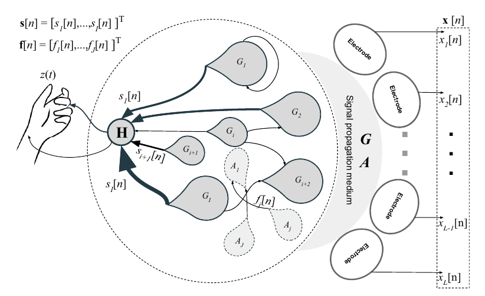

**Рисунок 1.** Феноменологическая схема. Обозначения на схеме: *Electrode* — электрод; *Signal propagation medium* — среда распространения сигнала. Источники $G_i$ связаны с задачей, источники $A_j$ с ней не связаны.

Векторы-столбцы $\mathbf{g}_i$, $i=1,\ldots,I$, и $\mathbf{a}_j$, $j=1,\ldots,J$, представляют топографии источников, соответственно связанных и не связанных с задачей. Шумовую составляющую записи, не связанную с задачей, мы обозначаем

$$
\boldsymbol{\eta}[n]=\sum_{j=1}^{J}\mathbf{a}_j f_j[n]\in\mathbb{R}^{L}.
$$

Сходная порождающая модель недавно описана в [32].

## Блок 7. Методы: пространственная фильтрация и двигательные ритмы — раздел 2, с. 3

Поскольку порождающая модель электрофизиологических данных линейна, обратное отображение, используемое для восстановления активности источников по сигналам датчиков, также обычно ищут в линейном виде: $\hat{\mathbf{s}}[n]=\mathbf{W}^{\mathsf{T}}\mathbf{X}[n]$. Столбцы $\mathbf{W}$ образуют пространственный фильтр, который компенсирует влияние объёмного проведения и уменьшает вклад шумовых источников, не связанных с задачей.

Нейронные корреляты планирования и выполнения движений подробно изучены [39]. Среди корковых ритмов альфа- и бета-компоненты сенсомоторного ритма десинхронизируются непосредственно перед выполнением движения, а после его окончания восстанавливаются со значительным превышением исходного уровня [19]. Величина этих модуляций коррелирует со способностью человека управлять ИМК на основе воображения движений [30]. Кроме того, частота возникновения бета-всплесков в первичной соматосенсорной коре обратно связана со способностью обнаруживать тактильные стимулы [35] и влияет на другие двигательные функции.

Внутричерепные записи, в том числе ЭКоГ, позволяют надёжно измерять более быструю гамма-активность, специфичную для движений во времени и пространстве [37] и, как предполагается, сопровождающую их управление и выполнение. Таким образом, обширные исследования указывают на полезность ритмических составляющих мозговых источников $\mathbf{s}[n]$ для реализации ИМК. Благодаря линейности модели (1) эти ритмические сигналы, отражающие активность определённых нейронных популяций, можно вычислять как линейные комбинации сигналов датчиков $\mathbf{x}[n]$, отфильтрованных в узких частотных полосах.

Самый прямой подход к извлечению кинематики $z[n]$ из мозговых записей $\mathbf{x}[n]$ — использовать одновременно зарегистрированные данные и непосредственно обучить отображение $z[n]=H(\mathbf{x}[n])$. Для практической реализации необходимо параметризовать это отображение. Мы использовали специальную архитектуру сети, построенную в тесном соответствии с уравнением наблюдения (1) и нейрофизиологическим описанием явлений на рисунке 1. Это облегчило интерпретацию результатов.

## Блок 8. Архитектура: параллельные ветви — раздел 2.1, с. 3–4

Использованная компактная адаптивная архитектура показана на рисунке 2. Она содержит $M$ ветвей. Каждая ветвь представляет собой адаптивный детектор огибающей с собственной парой временных фильтров, перед которыми расположен индивидуальный для этой ветви пространственный фильтр. Детектор приближённо вычисляет огибающую, получаемую как модуль аналитического сигнала, построенного с помощью преобразования Гильберта входного сигнала.

Такой конвейер напоминает аналоговый детекторный приёмник и уже применялся в сходных компактных CNN с раздельной обработкой пространственного и временного измерений [34, 40]. Каждая ветвь — параметрический конвейер, способный извлекать мгновенную мощность входного сигнала и настраиваться на определённую нейронную популяцию и частотную полосу посредством соответствующей настройки пространственных и временных весов.

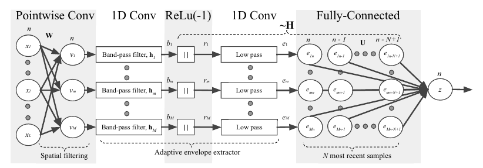

**Рисунок 2.** Архитектура компактной CNN содержит несколько ветвей — адаптивных детекторов огибающей. Они принимают пространственно разделённые входные сигналы и выдают огибающие. Их $N$ последних значений с индексами $n-N+1,\ldots,n$ объединяются полносвязным слоем в декодируемую переменную $z$. Для компактности временные индексы в названиях последовательностей на схеме опущены.

Обозначения на схеме: *Pointwise Conv* — поточечная свёртка; *1D Conv* — одномерная свёртка; *Fully-Connected* — полносвязный слой; *Band-pass filter* — полосовой фильтр; *Low pass* — низкочастотный фильтр; *Spatial filtering* — пространственная фильтрация; *Adaptive envelope extractor* — адаптивный экстрактор огибающей; *N most recent samples* — $N$ последних отсчётов.

## Блок 9. Архитектура: детектор огибающей — раздел 2.1, с. 4

Как показано на схеме, детектор огибающей реализуется с помощью стандартных элементов глубоких сетей: пары свёрточных операций, выполняющих полосовую и низкочастотную фильтрацию, с единственной нелинейностью $\operatorname{ReLU}(-1)$ между ними. Эта нелинейность соответствует вычислению модуля выхода первого слоя одномерной свёртки.

На данном этапе сигнал выпрямляется — аналогично двухполупериодному выпрямителю из пары диодов, — после чего низкочастотный фильтр сглаживает выход выпрямителя $r_m[n]$, давая приближение огибающей $e_m[n]$. Функция $\operatorname{ReLU}(a)$ — стандартная нелинейность современных сетей, определяемая как

$$
\operatorname{ReLU}(x,a)=\begin{cases}x,&x\geq0,\\ ax,&x<0.\end{cases}
$$

Чтобы решающее правило архитектуры допускало анализ, при прохождении данных через неё мы использовали необучаемую пакетную нормализацию. Это позволяет применять средства оптимизации глубокого обучения для настройки параметров сети, в которой извлечение признаков состоит из пространственной фильтрации и последующей оценки огибающей.

## Блок 10. Архитектура: предсказание кинематики — раздел 2.1, с. 4

Детектор огибающей $m$-й ветви получает на вход пространственно отфильтрованный сигнал датчиков $s_m[n]$, вычисленный слоем поточечной свёртки. Этот слой предназначен для обращения процессов объёмного проведения, представленных матрицами прямой модели $\mathbf{G}$ и $\mathbf{A}$ в нашей феноменологической модели (рисунок 1).

Затем оператор $H$ аппроксимируется линейной комбинацией запаздывающих значений мгновенной мощности — огибающей — узкополосных временных рядов источников $\mathbf{s}(t)=[s_1(t),\ldots,s_I(t)]$. Коэффициенты комбинации составляют матрицу $\mathbf{U}=\{u_{ml}\}$, где $m=1,\ldots,M$, $l=1,\ldots,N$.

Это реализовано полносвязным слоем, который объединяет отсчёты огибающих $e_m[n]$ в единую оценку кинематического параметра:

$$
z[n]=\sum_{m=1}^{M}\sum_{l=1}^{N}e_m[n-l]u_{ml}+u_0,
$$

где $u_0$ моделирует постоянное смещение, которое может присутствовать в кинематическом профиле.

## Блок 11. Две регрессионные задачи: совместная фильтрация — раздел 2.2, с. 4

Архитектура обрабатывает данные фрагментами заранее заданной длины $N$ отсчётов. Сначала предположим, что длина фрагмента равна длине фильтра в слоях одномерной свёртки. Рассмотрим фрагмент входных данных $L$ каналов за $N$ моментов времени. Его можно представить матрицей Тёплица

$$
\mathbf{X}[n]=[\mathbf{x}[n],\mathbf{x}[n-1],\ldots,\mathbf{x}[n-N+1]]\in\mathbb{R}^{L\times N}.
$$

Для $m$-й ветви обработка первыми двумя слоями, выполняющими пространственную и временную фильтрацию, записывается как

$$
b_m[n]=\mathbf{w}_m^{\mathsf{T}}\mathbf{X}[n]\mathbf{h}_m.\tag{2}
$$

Здесь $\mathbf{w}_m\in\mathbb{R}^{L}$ — пространственные веса, а $\mathbf{h}_m\in\mathbb{R}^{N}$ — временные веса ветви $m$. Нелинейность $\operatorname{ReLU}(-1)$ в сочетании с низкочастотной фильтрацией во втором свёрточном слое извлекает огибающие ритмических сигналов.

## Блок 12. Две регрессионные задачи: аргумент об огибающей — раздел 2.2, с. 4–5

Аналитический сигнал взаимно однозначно отображается в свою огибающую [6], а для исходных вещественных данных мнимая часть аналитического сигнала однозначно вычисляется преобразованием Гильберта. Поэтому исходному вещественному сигналу однозначно соответствует его огибающая. Наш детектор вычисляет близкое приближение модуля аналитического сигнала, и потому мы можем утверждать, что $e_m[n]$ однозначно определяется $b_m[n]$. Следовательно, для получения правильной огибающей $e_m[n]$ достаточно получить правильный $b_m[n]$, что достигается настройкой пространственных и временных свёрточных весов каждой ветви компактной CNN.

Предположим, что обучение адаптивных детекторов огибающей привело к оптимальным пространственным и временным весам, обозначенным звёздочками: $\mathbf{w}_m^*$ и $\mathbf{h}_m^*$. Предположим также, что эти веса действительно извлекают истинные сигналы активности популяций $b_m^*[n]$. Они однозначно задают огибающие $e_m^*[n]$, которые, в свою очередь, порождают искомую кинематику $z[n]$ после преобразования нелинейным оператором $H()$, аппроксимируемым полносвязным слоем сети.

> Примечание переводчика: утверждение о взаимной однозначности в первом предложении передано по оригиналу. Его не следует воспринимать как общее утверждение, что произвольный вещественный сигнал можно восстановить только по его огибающей.

## Блок 13. Две регрессионные задачи: оптимальные веса — раздел 2.2, с. 5

Представим, что пространственные веса неизвестны, а временные зафиксированы на оптимальном значении $\mathbf{h}_m^*$. Тогда оптимальные пространственные веса можно найти как решение выпуклой задачи оптимизации по пространственному подмножеству параметров:

$$
\begin{aligned}
\mathbf{w}_m^*&=\operatorname*{argmin}_{\mathbf{w}_m}\left\{\left\|b_m^*[n]-\mathbf{w}_m^{\mathsf{T}}\mathbf{X}[n]\mathbf{h}_m^*\right\|_2^2\right\}\\
&=\operatorname*{argmin}_{\mathbf{w}_m}\left\{\left\|b_m^*(n)-\mathbf{w}_m^{\mathsf{T}}\mathbf{y}_m[n]\right\|_2^2\right\}.
\end{aligned}\tag{3}
$$

Здесь $\mathbf{y}_m[n]=\mathbf{X}[n]\mathbf{h}_m^*$ — вектор многоканальных данных после временной фильтрации. Аналогично, если пространственные веса зафиксированы на оптимальном значении $\mathbf{w}_m^*$, временные веса определяются уравнением

$$
\begin{aligned}
\mathbf{h}_m^*&=\operatorname*{argmin}_{\mathbf{h}_m}\left\{\left\|b_m^*[n]-\mathbf{w}_m^{*\mathsf{T}}\mathbf{X}[n]\mathbf{h}_m\right\|_2^2\right\}\\
&=\operatorname*{argmin}_{\mathbf{h}_m}\left\{\left\|b_m^*[n]-\mathbf{v}_m^{\mathsf{T}}[n]\mathbf{h}_m\right\|_2^2\right\},
\end{aligned}\tag{4}
$$

где $\mathbf{v}_m[n]=[v_m[1],\ldots,v_m[N]]^{\mathsf{T}}=\mathbf{X}^{\mathsf{T}}[n]\mathbf{w}_m^*$ — фрагмент входного сигнала после пространственной фильтрации.

## Блок 14. Пространственные паттерны: учёт временного фильтра — раздел 2.2, с. 5

При заданных прямой модели (1) и регрессионной задаче (3), если предположить взаимную статистическую независимость ритмических потенциалов $s_m[n]$, $m=1,\ldots,M$, топографии соответствующих нейронных популяций определяются следующим образом [8, 11]:

$$
\mathbf{g}_m=\mathbb{E}\{\mathbf{y}_m[n]\mathbf{y}_m^{\mathsf{T}}[n]\}\mathbf{w}_m^*
=\mathbf{R}_m^y\mathbf{w}_m^*.\tag{5}
$$

Здесь $\mathbf{R}_m^y=\mathbb{E}\{\mathbf{y}_m[n]\mathbf{y}_m^{\mathsf{T}}[n]\}$ — пространственная ковариационная матрица размера $L\times L$ для данных после временной фильтрации. Предполагается, что временные ряды каналов — случайные процессы с нулевым средним; $L$ — число входных каналов.

Таким образом, при интерпретации пространственных весов каждой из $M$ ветвей архитектуры на рисунке 2 необходимо учитывать временные веса $\mathbf{h}_m^*$, на которые настроена эта ветвь. Поэтому для преобразования пространственных весов разных ветвей в пространственные паттерны следует использовать отдельные для ветвей ковариационные матрицы $\mathbf{R}_m^y$, зависящие от временных свёрточных весов каждой ветви.

Это становится очевидным, если вспомнить, что пространственная и временная фильтрация линейны и их порядок можно менять. Однако поскольку каждая ветвь имеет собственный временной фильтр, на схеме архитектуры удобнее сначала показывать пространственное разделение, а затем временную фильтрацию.

Если рассмотреть одну ветвь, поменять порядок операций и сначала применить один и тот же временной фильтр ко всем каналам, а затем пространственный фильтр, выражение (5) становится интуитивно понятным на основании вывода из [8]. Следовательно, для интерпретации пространственных весов $m$-й ветви необходимо использовать пространственную ковариацию данных, отфильтрованных временным фильтром именно этой ветви.

## Блок 15. Временные паттерны: учёт пространственного фильтра — раздел 2.2, с. 5

Временные веса можно интерпретировать аналогично. Временной паттерн вычисляется как

$$
\mathbf{q}_m=\mathbb{E}\{\mathbf{v}_m[n]\mathbf{v}_m^{\mathsf{T}}[n]\}\mathbf{h}_m^*
=\mathbf{R}_m^v\mathbf{h}_m^*.\tag{6}
$$

Здесь $\mathbf{R}_m^v=\mathbb{E}\{\mathbf{v}_m[n]\mathbf{v}_m^{\mathsf{T}}[n]\}$ — ковариационная матрица размера $N\times N$ между задержанными отсчётами пространственно отфильтрованных данных. Временные ряды каналов предполагаются случайными процессами с нулевым средним. $N$ — число коэффициентов временного свёрточного фильтра и длина обрабатываемого за один раз фрагмента данных.

Как и для пространственных паттернов, при интерпретации временных весов отдельных ветвей архитектуры на рисунке 2 необходимо учитывать пространственные веса $\mathbf{w}_m$, формирующие вход каждой ветви. Поэтому для преобразования временных свёрточных весов в паттерны следует использовать индивидуальные для ветвей ковариационные матрицы задержанных отсчётов $\mathbf{R}_m^v$, зависящие от пространственных весов поточечной свёртки соответствующей ветви.

Чтобы интерпретировать вектор временного паттерна $\mathbf{q}_m=[q_m[0],\ldots,q_m[N-1]]^{\mathsf{T}}$, мы обычно рассматриваем его в частотной области:

$$
Q_m[k]=\sum_{n=0}^{N-1}q_m[n]e^{-j2\pi kn/N},\qquad k=0,\ldots,N-1.
$$

Это дискретное преобразование Фурье (ДПФ) вектора временного паттерна конечной длины для $m$-й ветви. Индекс $n$ обозначает дискретное время, а $k$ — частотный отсчёт.

Важно понимать, что временной паттерн $Q_m[k]$ нейронной популяции представляет собой спектральную плотность мощности её активности. В сочетании с пространственным паттерном он полностью описывает динамические свойства второго порядка и пространственное положение популяции. Подобно тому как пространственные веса не равны пространственному паттерну [8], временные веса и их представление Фурье не отражают динамические свойства лежащей в основе сигнала нейронной популяции.

## Блок 16. Переход к частотному описанию — раздел 2.2, с. 5–6

Выше для наглядности мы описывали работу свёрточного слоя CNN с помощью временного вложения. Это позволило подчеркнуть формальное сходство временного и пространственного измерений и показать: интерпретация временных паттернов требует учитывать корреляционную структуру независимой переменной в регрессионной модели, построенной на пространственно отфильтрованных данных.

Более общее и практически удобное описание можно получить, рассматривая работу архитектуры с продолжительным фрагментом сигнала, когда пространственные и временные фильтры применяются в скользящем окне. Тогда полосовая временная фильтрация в $m$-й ветви записывается как свёртка двух последовательностей: $b_m[n]=h_m[n]\times v_m[n]$. См. рисунок 2 и определение $\mathbf{v}_m[n]$ после выражения (4).

Описанная архитектура выполняет пространственную и временную фильтрацию, чтобы выделить сигналы активности значимых популяций $s_m[n]$. Для работы со свёрткой и вывода общего правила для временного паттерна, определяемого как спектральная плотность мощности активности целевой популяции, удобнее перейти в частотную область и использовать стандартные рассуждения теории фильтрации Винера.

Мы предполагаем, что в результате обучения пространственный фильтр достиг оптимального значения $\mathbf{w}^*[n]$, а временные веса $\mathbf{h}_m$ оптимальны по Винеру и дают наилучшую оценку $s_m[n]$ в смысле наименьших квадратов. Тогда можно связать спектральную плотность мощности активности лежащей в основе сигнала нейронной популяции с пространственно отфильтрованными данными датчиков $v_m^*[n]$.

Сигнал $v_m^*[n]=\mathbf{w}_m^{*\mathsf{T}}\mathbf{x}[n]$ — это зашумлённая смесь неизвестной активности значимой популяции $s_m[n]$ и активности других, не связанных с задачей популяций $A_1,\ldots,A_J$, обозначаемой $u_m[n]=\mathbf{w}_m^{*\mathsf{T}}\boldsymbol{\eta}[n]$. Иными словами,

$$
v_m^*[n]=\mathbf{w}_m^{*\mathsf{T}}\mathbf{x}[n]=s_m[n]+u_m[n].\tag{7}
$$

## Блок 17. Фильтр Винера и спектральный паттерн — раздел 2.2, с. 6

В частотной области веса фильтра Винера $h_m^*[n]$, предназначенного для выделения полезного для декодирования сигнала из зашумлённого пространственно отфильтрованного $v_m^*[n]$, выражаются через его спектральную плотность мощности $P_m^{v^*v^*}[k]$ и взаимный спектр $P_m^{sv^*}[k]$ неизвестного сигнала активности популяции $s_m[n]$ и данных $v_m^*[n]$ [24]:

$$
H_m^*[k]=\frac{P_m^{sv^*}[k]}{P_m^{v^*v^*}[k]}.\tag{8}
$$

Следуя стандартному выводу фильтра Винера, предположим статистическую независимость $\boldsymbol{\eta}[n]$ и $\mathbf{s}[n]$ в (1), что, в свою очередь, означает статистическую независимость $s_m[n]$ и $v_m[n]$ в (7). Тогда $P^{sv^*}[k]=P_m^{ss}[k]$ и $P_m^{v^*v^*}[k]=P_m^{ss}[k]+P_m^{uu}[k]$, и передаточная функция оптимального фильтра Винера имеет вид

$$
H_m^*[k]=\frac{P_m^{ss}[k]}{P_m^{ss}[k]+P_m^u[k]}
=\frac{P_m^{ss}[k]}{P_m^{vv}[k]}.\tag{9}
$$

> Примечание переводчика: в предыдущем предложении оригинал действительно указывает независимость $s_m$ и $v_m$. Судя по (7) и дальнейшему выводу, здесь имеется в виду независимость $s_m$ и шумовой составляющей $u_m$. В знаменателе (9) оригинал использует обозначение $P_m^u$, тогда как непосредственно перед формулой — $P_m^{uu}$. Эти расхождения не исправлены молча.

Следовательно, частотный паттерн $Q_m^*[k]$, соответствующий спектральной плотности мощности активности нейронной популяции, на которую настроена $m$-я ветвь, вычисляется как

$$
Q_m^*[k]=P_m^{ss}[k]=P_m^{vv}[k]H_m^*[k].\tag{10}
$$

Здесь $H_m^*[k]$ — преобразование Фурье вектора временных свёрточных весов $\mathbf{h}_m^*$, полученного при адаптации детектора огибающей $m$-й ветви. С точки зрения обучения можно сказать: обучаясь декодировать, мы получаем доступ к спектральному паттерну (10) активности популяции, существенной для данной задачи.

Сами по себе временные веса информативны о спектральном паттерне активности популяции только тогда, когда входной временной ряд $v_m^*[n]$ является белым. Выражение (10) — частотный эквивалент уравнения (6), полученного в представлении с временным вложением.

## Блок 18. Как использовать восстановленные паттерны — раздел 2.2, с. 6

Пространственные паттерны нейронных источников $\mathbf{g}_m$, восстановленные по весам пространственных фильтров [8], определяют пространственное положение популяции. Их регулярно используют для подбора дипольных моделей с целью локализации функционально значимых источников [20]. Спектральные паттерны, интерпретированные согласно (10) и (6), можно использовать для подбора моделей динамики нейронных популяций, соответствующих определённой задаче декодирования; пример приведён в [22].

## Блок 19. Моделирование данных — раздел 2.3, с. 6

Для исследования предложенного подхода мы выполнили серию симуляций, соответствующих феноменологической схеме на рисунке 1. Мы моделировали $I=4$ связанных с задачей источника с ритмическими потенциалами $s_i[n]$. Потенциалы этих популяций задавались узкополосными процессами в четырёх поддиапазонах гамма-ритма: 30–80, 80–120, 120–170 и 170–220 Гц. Их получали фильтрацией гауссовских псевдослучайных последовательностей банком фильтров с конечной импульсной характеристикой (КИХ, FIR).

Затем кинематику $z[n]$ моделировали как линейную комбинацию четырёх огибающих этих ритмических сигналов со случайно сгенерированными коэффициентами. Не связанные с задачей ритмические источники создавали аналогично, но с фильтрацией в диапазонах 40–70, 90–110, 130–160 и 180–210 Гц. В каждой полосе моделировали десять источников — всего 40 источников, не связанных с задачей.

Для моделирования объёмного проведения и регистрации активности электродами мы случайно генерировали матрицу прямой модели $\mathbf{G}$ размера $4\times5$ и матрицу $\mathbf{A}$ размера $40\times5$. Они отображали соответственно связанную и не связанную с задачей активность в пространство датчиков. В каждой реализации Монте-Карло генерировали новые матрицы смешивания и временные ряды источников. К данным датчиков также добавляли шум $1/f$, моделирующий пространственно некоррелированный мозговой шум.

> Примечание переводчика: размеры матриц в этом абзаце воспроизведены по оригиналу. При векторной записи (1) и пяти датчиках соответствующие матрицы имели бы размеры $5\times4$ и $5\times40$; исходник здесь использует обратный порядок размерностей.

Мы генерировали 20 минут данных с частотой дискретизации 1000 Гц и делили их на две равные последовательные части. Первая использовалась для обучения, вторая — для тестирования.

## Блок 20. Экспериментальные данные: BCI Competition IV — раздел 3, с. 6–7

Сначала, чтобы сравнить компактную CNN с лучшими линейными моделями, использующими заранее заданные признаки, мы взяли общедоступные данные Kubanek и соавторов из Berlin BCI Competition IV. Этот набор содержит одновременно зарегистрированные многоканальные ЭКоГ и кинематику сгибания пальцев трёх пациентов с эпилепсией, которым электроды были имплантированы по медицинским показаниям.

Набор включает 400 секунд обучающих и 200 секунд тестовых данных. Записи получены с 64 или 48 электродов над сенсомоторной корой. Точные пространственные положения и порядок электродов не предоставлены.

В качестве опорного метода мы выбрали победившее решение Nanying Liang и Laurent Bougrain [16]. Оно извлекает амплитуды сигналов после фильтрации в полосах 1–60, 60–100 и 100–200 Гц, затем выполняет попарный отбор признаков и декодирование фильтром Винера, использующим $N=25$ последних отсчётов.

## Блок 21. Экспериментальные данные: собственные записи ЭКоГ — раздел 3, с. 7

Следующий набор получен в нашей лаборатории Центра биоэлектрических интерфейсов (CBI). Записи выполнялись 64-канальной микрорешёткой Adtech, подключённой к усилителю EB Neuro BE Plus LTM с частотой дискретизации 2048 Гц. Программное обеспечение усилителя передавало данные по протоколу Lab Streaming Layer. Экспериментальная программа поддерживала этот протокол, реализовывала задачу движений пальцев и синхронизировала ЭКоГ с кинематикой.

Кинематику регистрировали системой Perception Neuron как относительные углы датчиков, закреплённых на фалангах пальцев, с частотой 120 Гц. Угол сгибания и разгибания пальца использовался как кинематический временной ряд $z[n]$.

Записи получены у двух пациентов с фармакорезистентной эпилепсией. Электроды ЭКоГ имплантированы для предоперационной локализации эпилептических очагов и картирования функционально значимой коры. Поэтому, в отличие от данных Berlin BCI Competition IV, положения электродов относительно коры были известны и позволяли визуализировать пространственные паттерны активности. Пациенты в течение одной минуты сгибали каждый палец в самостоятельно выбранном темпе.

Исследование соответствовало этическим стандартам Хельсинкской декларации 1964 года. Все участники дали письменное информированное согласие до начала экспериментов. Протокол одобрен комитетом по этике исследований НИУ ВШЭ.

## Блок 22. Экспериментальные данные: ЭЭГ при воображении движений — раздел 3, с. 7

Наконец, мы применили архитектуру к 32-канальному набору ЭЭГ, зарегистрированному с частотой 250 Гц у одного участника, выполнявшего воображаемые движения. Всего использовались четыре состояния: воображение движения левой кисти, правой кисти, ног и покой.

ЭЭГ делили на перекрывающиеся сегменты длиной 2 секунды с шагом 0,2 секунды. Каждый сегмент относился к одному двигательному состоянию. Сегменты первой непрерывной части записи использовались для обучения, остальные — для тестирования.

## Блок 23. Результаты симуляций: адаптивный детектор огибающей — раздел 4.1, с. 7–8

Как описано в разделе 2, для интерпретации оптимальных весов временной свёртки необходимо учитывать спектральные характеристики нейронных записей. Для иллюстрации мы начали с упрощённых симуляций: один связанный с задачей источник занимал полосу 50–150 Гц, а один мешающий источник был активен в диапазоне 50–100 Гц, входящем в полосу полезного сигнала. Мы обучили одноканальный детектор огибающей, $M=1$.

Как видно на рисунке 3, профиль Фурье найденных временных весов нельзя использовать для оценки спектральной плотности мощности исходного источника: он имеет характерное подавление в полосе помехи. Причина уменьшенного усиления в этой полосе следует из передаточной функции фильтра Винера (9). При наличии помехи, то есть $P_m^{\eta\eta}[k]\ne0$, усиление меньше единицы. В симуляциях рисунка 3 помеха занимала полосу 50–100 Гц.

При этом выражение (10) даёт корректный паттерн, хорошо соответствующий смоделированному спектру. Использование непосредственно ДПФ свёрточных весов, напротив, приводит к принципиально ошибочной оценке частотных паттернов и потенциально неверной нейрофизиологической интерпретации.

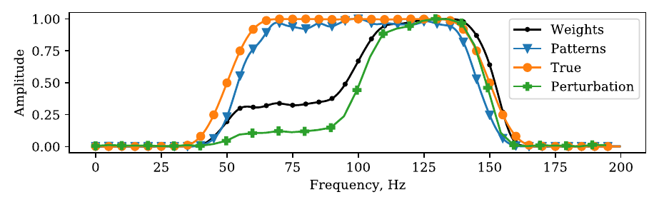

**Рисунок 3.** Три способа интерпретации весов временной свёртки. Истинный паттерн динамической активности — спектральная плотность мощности источника — показан оранжевыми звёздочками; представление Фурье временных весов — чёрными точками; метод Ball — зелёными плюсами; динамический паттерн источника, восстановленный предложенным подходом, — синими перевёрнутыми треугольниками.

## Блок 24. Результаты реалистичных симуляций — раздел 4.2, с. 7–10

На смоделированных данных алгоритм обучали предсказывать кинематическую переменную $z[n]$. При отсутствии шума архитектура достигла качества 99%, измеренного коэффициентом корреляции между истинной и оценённой кинематикой; см. рисунок 4.

Затем мы сравнили огибающие в четырёх ветвях сети и обнаружили хорошее совпадение истинных скрытых временных рядов — огибающих узкополосных сигналов — с оценками сети. На рисунке 5 оценённые огибающие $r_m[n]$ наложены на истинные огибающие и соответствующий узкополосный процесс $b_m[n]$ (рисунок 2). Парные коэффициенты корреляции оценённых и истинных огибающих составляют 98–99%.

Для интерпретации пространственных весов мы использовали подход линейной теории оценивания [8, 11]. Чтобы продемонстрировать опасность его наивного применения к архитектурам, совмещающим пространственную и временную фильтрацию, мы также вычислили пространственные паттерны по ковариации исходных данных $\mathbf{R}^x$, без учёта временных фильтров отдельных ветвей. На графиках эти оценки обозначены *Patterns naive* — «наивные паттерны». Правильное применение подхода требует вычислять пространственную ковариацию $\mathbf{R}^y$ после временной фильтрации (6). Такие оценки далее обозначены *Patterns* — «паттерны».

В правом столбце рисунка 6 показаны пространственные паттерны всех четырёх ветвей для случая без шума. Как и ожидалось, наивные и корректные паттерны совпадают и точно воспроизводят истинные значения. В левом столбце представлены частотные паттерны и веса: без шума представления Фурье временных весов точно совпадают со спектральной плотностью мощности смоделированных данных.

В случае с шумом на рисунке 7 только корректные паттерны хорошо соответствуют истинным топографиям источников. Спектральные характеристики обученных временных фильтров имеют характерные провалы в полосах мешающих источников. Применение (10) компенсирует провалы и даёт спектральные паттерны, более близкие к смоделированным.

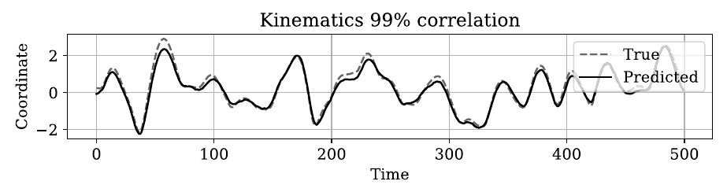

**Рисунок 4.** Реалистичные симуляции: истинная и декодированная кинематика.

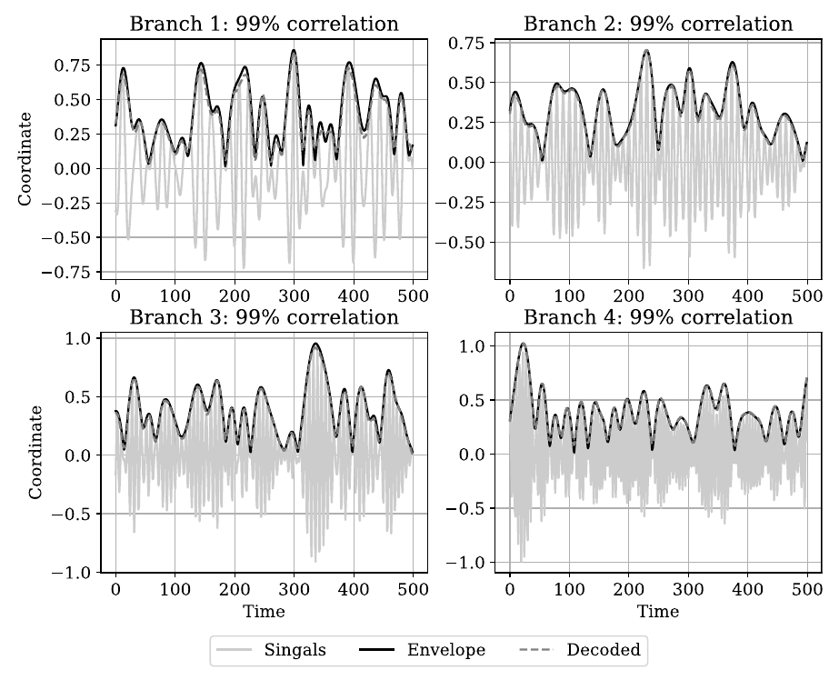

**Рисунок 5.** Декодирование огибающих ветвей. Сравнение истинной и декодированной огибающей в каждой из четырёх ветвей.

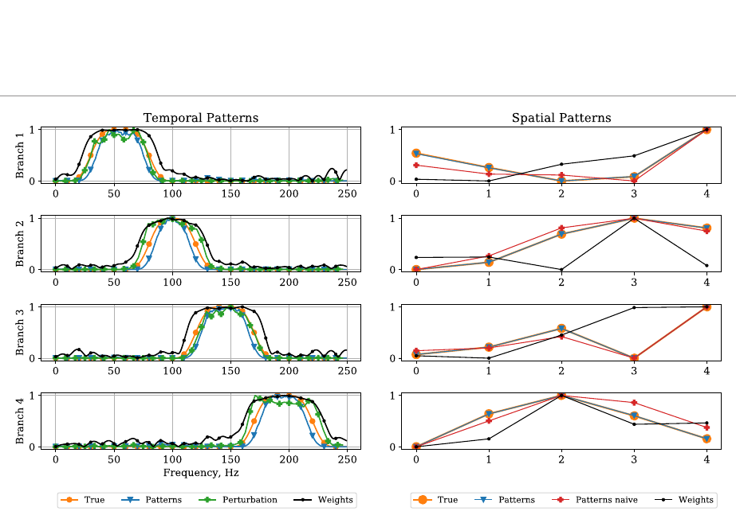

**Рисунок 6.** Временные паттерны слева и пространственные справа в случае без шума. Описание приведено в основном тексте.

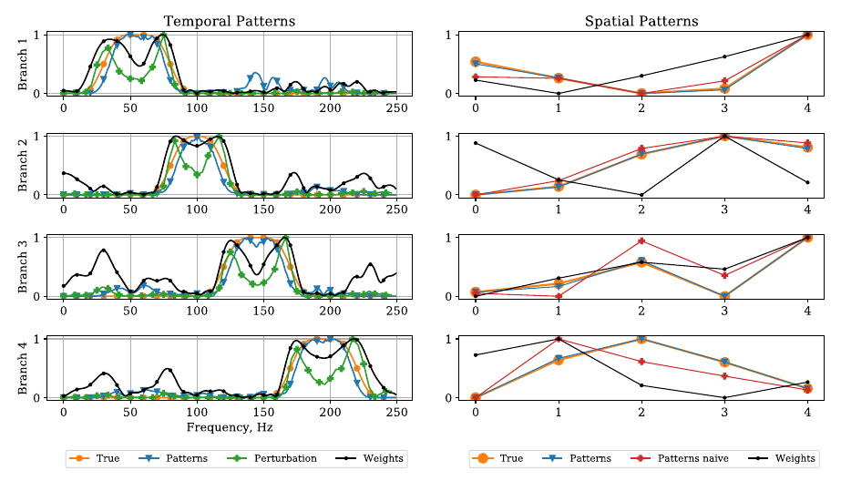

**Рисунок 7.** Временные паттерны слева и пространственные справа при наличии шума, отношение сигнал/шум SNR = 1,5. Описание приведено в основном тексте.

> Примечание переводчика: в исходном тексте сохранены две особенности обозначений: оценённые огибающие в этом абзаце названы $r_m$, хотя ранее огибающая обозначалась $e_m$; ссылка «(6)» при описании пространственной ковариации приведена по оригиналу, тогда как формула пространственного паттерна имеет номер (5).

## Блок 25. Симуляции Монте-Карло — раздел 4.3, с. 8–10

На предыдущих графиках рассмотрены два отдельных случая работы архитектуры — с шумом и без него — при фиксированном пространственном расположении связанных и не связанных с задачей источников, задаваемом матрицами $\mathbf{G}$ и $\mathbf{A}$.

Для проверки подхода к интерпретации весов мы провели исследование Монте-Карло с изменением пространственной конфигурации источников в каждой реализации и четырьмя уровнями шума. Элементы матриц $\mathbf{G}$ и $\mathbf{A}$, моделирующих объёмное проведение, в каждой реализации случайно генерировали из распределения $\mathcal{N}(0,1)$. Создавали 20 минут данных с частотой дискретизации 1000 Гц.

Сеть обучали оптимизатором Adam примерно 15 тысяч шагов. После 5 и 10 тысяч шагов скорость обучения уменьшали вдвое, чтобы получить более точные паттерны. Всего выполнено более трёх тысяч симуляций. Для каждой реализации данных алгоритм обучали предсказывать $z[n]$, после чего вычисляли паттерны источников, к которым отдельные ветви сети в результате обучения «подключились».

Рисунок 8 показывает, что только пространственные паттерны, интерпретированные с учётом временных фильтров отдельных ветвей — синие точки, — хорошо соответствуют истинным топографиям смоделированных источников. Спектральные паттерны предложенного метода также хорошо согласуются с истинными спектральными профилями. Непосредственное рассмотрение коэффициентов Фурье временных весов обычно приводит к ошибочным профилям — красные треугольники. Для пространственных паттернов показаны также наивные оценки без учёта временной фильтрации ветвей — зелёные точки.

Таким образом, корректные спектральные паттерны нейронной популяции позволяют подбирать биологически правдоподобные модели, например [22], и раскрывать действительные нейрофизиологические механизмы декодируемого процесса.

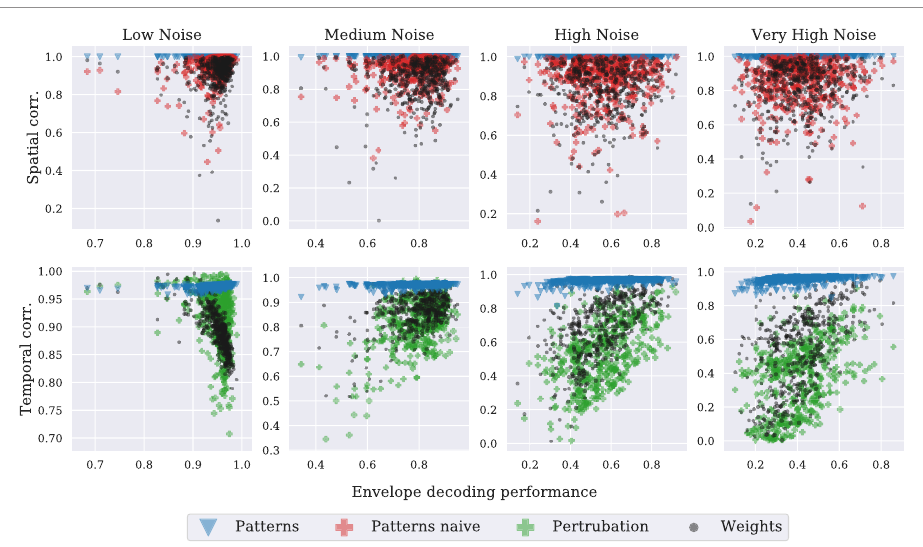

**Рисунок 8.** Симуляции Монте-Карло. Координаты точки отражают качество декодирования огибающей по оси $x$ и корреляцию с истинным паттерном по оси $y$ в каждой реализации. Цвет точки обозначает метод вычисления паттерна. *Weights* — непосредственная интерпретация весов; *Patterns naive* — пространственные паттерны без учёта временных фильтров ветвей; *Patterns* — предложенный метод.

## Блок 26. Реальные данные: BCI Competition IV — раздел 5.1, с. 10–11

При обработке электрофизиологических данных главное преимущество архитектур, основанных на принципах глубокого обучения, — способность автоматически выбирать признаки в ходе решения задачи классификации или регрессии [31].

На данных Berlin BCI Competition IV мы не обнаружили значимых различий между качеством компактной CNN и победившим решением Liang и Bougrain [16]: критерий Манна — Уитни, $U=103{,}0$, $p=0{,}3543$; см. таблицу 1. При этом CNN автоматически формировала признаки.

**Таблица 1.** Сравнение предложенной архитектуры NET и победившего решения Winner на наборе 4 соревнования Berlin BCI Competition IV. Знак «±» обозначает стандартное отклонение качества при разных запусках обучения.

| Участник | Метод | Большой | Указательный | Средний | Безымянный | Мизинец |
|---|---|---:|---:|---:|---:|---:|
| 1 | Winner | 0,58 | 0,71 | 0,14 | 0,53 | 0,29 |
| 1 | NET | 0,54 ± 0,03 | 0,70 ± 0,02 | 0,20 ± 0,07 | 0,58 ± 0,03 | 0,25 ± 0,06 |
| 2 | Winner | 0,51 | 0,37 | 0,24 | 0,47 | 0,35 |
| 2 | NET | 0,50 ± 0,03 | 0,36 ± 0,04 | 0,22 ± 0,06 | 0,40 ± 0,04 | 0,23 ± 0,06 |
| 3 | Winner | 0,69 | 0,46 | 0,58 | 0,58 | 0,63 |
| 3 | NET | 0,71 ± 0,02 | 0,48 ± 0,03 | 0,50 ± 0,02 | 0,52 ± 0,02 | 0,61 ± 0,02 |

## Блок 27. Реальные данные: собственные ЭКоГ и их интерпретация — раздел 5.2, с. 11–13

Мы также применили предложенные решения к записям двух пациентов с микрорешётками ЭКоГ $8\times8$, расположенными над сенсомоторной корой. Пациенты выполняли сгибания отдельных пальцев; см. раздел 3. Таблица 2 показывает качество декодирования, достигнутое предложенной архитектурой.

**Таблица 2.** Качество декодирования у двух пациентов CBI. Приведены коэффициенты корреляции между истинными и декодированными траекториями пальцев. Знак «±» обозначает стандартное отклонение при разных запусках обучения. Жирным выделены пальцы, для которых показаны рисунки 9 и 10.

| Участник | Большой | Указательный | Средний | Безымянный | Мизинец |
|---|---:|---:|---:|---:|---:|
| 1 | 0,48 ± 0,04 | **0,79 ± 0,02** | 0,77 ± 0,03 | 0,61 ± 0,03 | 0,32 ± 0,05 |
| 2 | 0,73 ± 0,02 | 0,55 ± 0,03 | 0,72 ± 0,03 | 0,78 ± 0,02 | **0,79 ± 0,01** |

> Примечание переводчика: в подписи оригинала говорится о четырёх пальцах, но сама таблица содержит пять столбцов пальцев. Числа и состав столбцов сохранены.

Рисунки 9 и 10 показывают интерпретацию полученных пространственных и временных весов для пальца с наибольшим качеством декодирования у каждого из двух пациентов. Архитектура декодера в обоих случаях содержала три ветви, каждая из которых настраивалась на источник с определёнными пространственными и временными паттернами.

На рисунке 9 представлены пространственные веса, наивные паттерны и корректные паттерны, интерпретированные по выражению из раздела 2. В первых двух ветвях временные веса — чёрные точки — явно подчёркивали частоты выше 100 Гц. Однако восстановленный спектральный паттерн источника — синие треугольники — наряду с гамма-составляющей имел пик около 11 Гц в первой и второй ветвях, а также в диапазоне 25–50 Гц во второй ветви. Вероятно, эти пики соответствуют сенсомоторному ритму и низкочастотным гамма-ритмам.

Третья ветвь, по-видимому, выделяет более низкие частоты; её пространственный паттерн заметно более диффузен, чем у первых двух ветвей, выделяющих высокочастотные компоненты.

Сходные наблюдения можно сделать по рисунку 10, показывающему декодирование мизинца второго пациента. Частотный паттерн второй ветви — синие треугольники — заметно отличается от простого ДПФ вектора весов — чёрных точек — и включает вклад более низкой полосы 20–45 Гц. При подборе динамических моделей активности популяции к восстановленному частотному паттерну эти низкочастотные компоненты, вероятно, существенно повлияют на параметры модели.

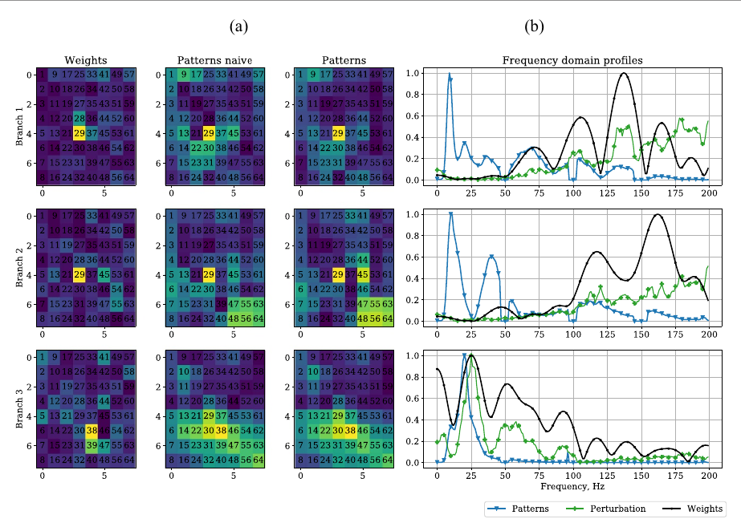

**Рисунок 9.** Интерпретация весов сети для декодера кинематики указательного пальца пациента CBI 1, ЭКоГ. Каждая строка соответствует одной из трёх ветвей обученного декодера. Панель (a): слева показаны пространственные веса с цветовым кодированием, затем наивно и корректно восстановленные пространственные паттерны. Синий соответствует минимальному абсолютному значению активации, жёлтый — максимальному. Панель (b): интерпретация временных весов в частотной области. БПФ весов — чёрные точки; спектральная плотность мощности $Q_m^*[k]$ локального полевого потенциала, полученная по (10), — синие перевёрнутые треугольники. Красные ромбы — спектральная плотность мощности выхода временного свёрточного блока. Зелёные плюсы — результаты анализа чувствительности методом возмущений [4, 34]. На рисунке 11 эти пространственные паттерны наложены на кору.

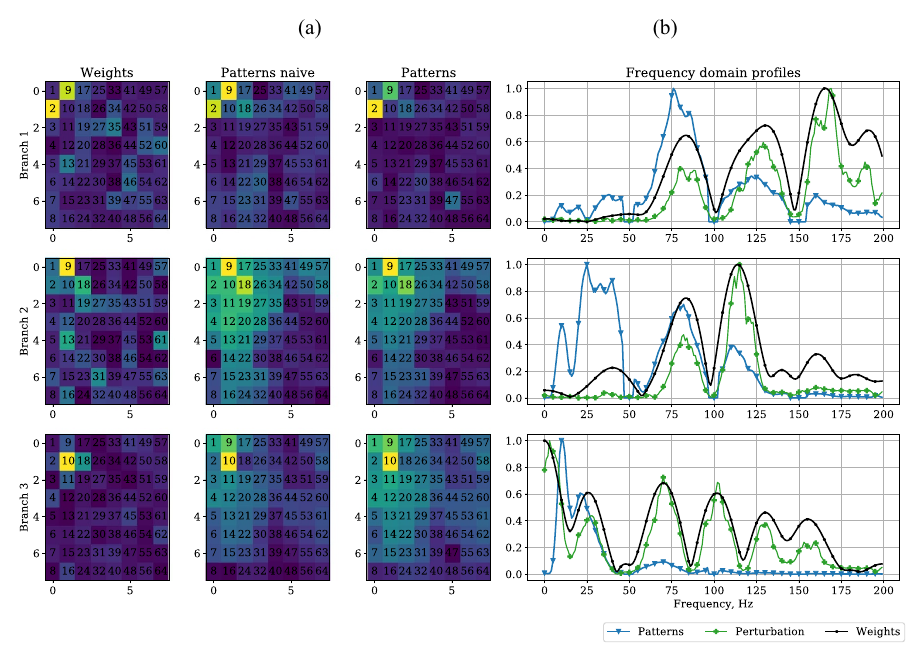

**Рисунок 10.** Интерпретация весов сети для декодера кинематики мизинца пациента CBI 2, ЭКоГ. Каждая строка соответствует одной из трёх ветвей. Панель (a): пространственные веса, наивно и корректно восстановленные пространственные паттерны; синий — минимальная абсолютная активация, жёлтый — максимальная. Панель (b): БПФ временных весов — чёрные точки; спектральная плотность мощности $Q_m^*[k]$ локального полевого потенциала по (10) — синие треугольники; спектральная плотность мощности выхода временной свёртки — красные ромбы; анализ чувствительности методом возмущений — зелёные плюсы.

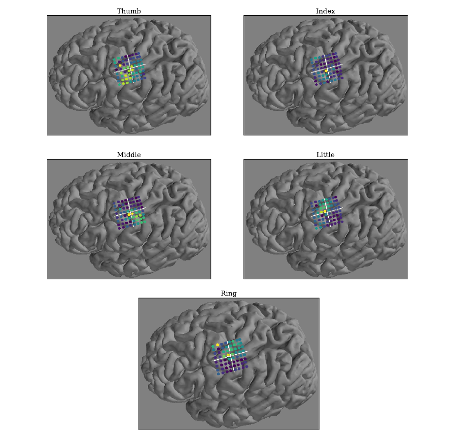

**Рисунок 11.** Пространственные паттерны, отображённые на коре. Синий цвет соответствует минимальной абсолютной активации, жёлтый — максимальной.

## Блок 28. Реальные данные: воображение движений по ЭЭГ — раздел 5.3, с. 12–14

В первых двух наборах требовалось непрерывно декодировать траектории по инвазивной ЭКоГ. Третий набор получен неинвазивно в парадигме ЭЭГ с дискретными состояниями воображения движений, описанной в разделе 3. Здесь требовалось классифицировать тип воображаемого движения.

Несмотря на небольшую продолжительность записи, компактная CNN достаточно хорошо выучила задачу и достигла среднего ROC AUC 0,83 для отдельной задачи. Оценка проводилась на тестовом сегменте, соответствующем второй половине данных и не перекрывающемся во времени с обучающим.

**Таблица 3.** Качество декодирования у третьего пациента CBI, ЭЭГ. Приведён ROC AUC для разных классов. Знак «±» обозначает стандартное отклонение при разных запусках обучения.

| Участник | Ноги | Правая кисть | Левая кисть | Покой |
|---|---:|---:|---:|---:|
| 3 | 0,75 ± 0,05 | 0,87 ± 0,06 | 0,88 ± 0,04 | 0,81 ± 0,05 |

Результаты интерпретации весов показаны на рисунке 12. Первый автоматически найденный паттерн отражает латерализованную затылочную альфа-активность, связь которой с двигательными задачами известна по предыдущим исследованиям [12, 28]. Как видно на панели (b), новый способ интерпретации временных весов ясно указывает на выраженный источник в альфа-диапазоне.

Вторая ветвь настроилась на область представительства кисти в сенсомоторной коре. Кривые *Patterns*, представляющие спектральную плотность мощности активности второй значимой популяции, показывают выраженные физиологически правдоподобные нижнюю и верхнюю компоненты сенсомоторного ритма — 10 и 20 Гц. БПФ весов даёт резко отличающуюся оценку спектра с акцентом на более высокие частоты 35–40 Гц. Пространственный паттерн, восстановленный наивным методом — средний столбец панели (a), — также вводит в заблуждение и не соответствует сенсомоторной области кисти.

Последний паттерн, по-видимому, выделяет источник в области представительства ног в сенсомоторной коре, активный в альфа-диапазоне. Подчеркнём, что все эти пространственные и временные паттерны были восстановлены автоматически, только по данным и конкретной задаче декодирования. Их анализ позволил получить представление об анатомических и динамических свойствах нейронных популяций, обеспечивающих механизмы воображения движений.

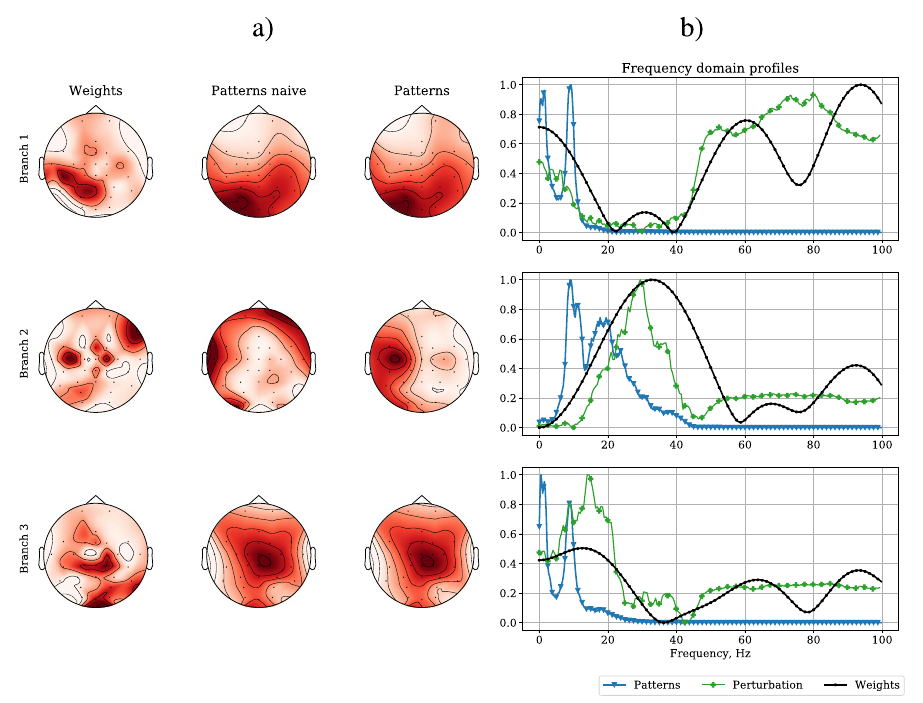

**Рисунок 12.** Интерпретация весов трёх ветвей декодера, обученного на ЭЭГ с воображением движений; каждая ветвь соответствует строке графиков. Панель (a): слева пространственные веса с цветовым кодированием, затем наивно и корректно восстановленные пространственные паттерны. Белый соответствует минимальной абсолютной активации, красный — максимальной. Панель (b): БПФ весов — чёрные точки; спектральная плотность мощности $Q_m^*[k]$ лежащего в основе сигнала локального полевого потенциала по (10) — синие перевёрнутые треугольники; спектральная плотность мощности выхода временной свёртки — красные ромбы; анализ чувствительности методом возмущений — зелёные плюсы.

## Блок 29. Заключение: что предложено и проверено — раздел 6, с. 14

Сначала мы описали нейрофизиологически интерпретируемую архитектуру компактной свёрточной сети с разделёнными пространственной и временной фильтрациями, сходную с ранее опубликованными [13, 34, 38, 40]. Используя эту архитектуру, мы распространили подход к интерпретации весов линейной регрессии [8] на анализ временных свёрточных весов и адаптировали его к многоветвевым архитектурам, где каждая ветвь имеет собственные пространственный и временной фильтры.

Подход проверен на реалистично смоделированных и экспериментальных данных. Чтобы приблизить симуляции к реальным условиям, мы включили активность связанных и не связанных с задачей популяций, которые решающее правило должно было разделить для декодирования кинематики. Активность моделировалась в расширенном гамма-диапазоне так, чтобы сигналы целевых популяций перекрывались с электрическими сигналами мешающих источников. Реалистичное перекрытие пространственных топографий обеспечивалось десятикратным различием числа связанных и не связанных с задачей источников.

## Блок 30. Заключение: точность паттернов и число параметров — раздел 6, с. 14–15

На реалистично смоделированных данных компактная CNN с высокой точностью восстанавливала смоделированный нейронный субстрат, вносивший вклад в кинематику. Интересно, что даже при невысоком качестве декодирования пространственные и временные паттерны оценивались достаточно точно; см. рисунок 8.

При этом пространственные паттерны восстанавливались заметно точнее временных, рассматриваемых в частотной области. Частично это может объясняться тем, что в наших симуляциях пространственный паттерн каждой ветви кодировался всего пятью коэффициентами, тогда как временные фильтры имели длину 100 коэффициентов.

Возможный способ уменьшить число определяемых параметров временной свёртки — использовать sinc-слой, описанный в [29] и применённый в сети для анализа акустических сигналов. Однако это уменьшает гибкость формирования спектральных характеристик отдельных ветвей. Для достижения сопоставимого качества может понадобиться больше ветвей, что усложнит интерпретацию решающего правила.

На данных Berlin BCI Competition IV компактная CNN показала качество декодирования, сходное с победившим решением [16], при этом не потребовала дополнительного ручного конструирования признаков. После обучения декодированию кинематики пальцев мы смогли интерпретировать её параметры и извлечь физиологически осмысленные паттерны, соответствующие пространственным и временным весам. Это продемонстрировано на собственных ЭКоГ-записях движений пальцев в произвольном темпе, для которых были известны положения электродов.

## Блок 31. Заключение: почему простая сеть остаётся глубокой — раздел 6, с. 15

Ранее уже описывались компактные глубокие архитектуры, сходные с нашей. Как мы показываем, главное преимущество простых архитектур с небольшим числом слоёв и нелинейных элементов — возможность непосредственно и теоретически обоснованно анализировать параметры согласно принципам линейной теории оценивания [11].

Мы продолжаем называть такие архитектуры глубокими нейронными сетями, поскольку они сохраняют характерное свойство DNN: используют первые слои для формирования признаков. Кроме того, наша архитектура ограничена извлечением физиологически осмысленных признаков, допускающих интерпретацию предложенными здесь подходами.

## Блок 32. Заключение: взаимосвязь пространственной и временной интерпретации — раздел 6, с. 15

В отношении пространственной обработки — объединения сигналов разных датчиков с заданными весами — каждая ветвь архитектуры на рисунке 2 соответствует модели из [8]. Поэтому, как мы показываем с помощью аргумента об однозначности огибающей [6], подход к интерпретации весов непосредственно применим к каждой ветви.

Наш вывод показывает: интерпретируя пространственные веса ветви, необходимо учитывать её собственный временной фильтр. Это может быть неочевидно по рисунку 2, поскольку для эффективности временная свёртка размещена после пространственной. Но линейность операций позволяет поменять их местами. Тогда принцип линейной теории оценивания, изложенный в [8], непосредственно применяется к пространственным весам каждой ветви, получающей данные после подходящей временной фильтрации.

В одном из примеров [8] рассматривается регрессионная задача, где признаки образуют вектор, содержащий отсчёты и из пространственной, и из временной области. Для интерпретации его коэффициентов нужна ковариационная матрица полного вектора размерности $LT$, сформированного на пространственно-временной сетке $L\times T$.

В нашей архитектуре и ряде других современных моделей — обзор см. в [31] — обработка факторизована на пространственную и временную области, и извлечение признаков каждой ветви задаётся вектором размерности $L+T$. Как мы показали, при фиксированных весах одной области определение весов другой становится простой регрессионной задачей, коэффициенты которой следует интерпретировать по правилам линейной теории оценивания.

Формально пространственные и временные веса рассматриваются одинаково. Для интерпретации временных весов и выявления временных паттернов, обычно отображаемых в частотной области, также требуется учитывать корреляционную структуру входного сигнала. Во временной области её описывает автокорреляция, а эквивалентно в частотной — спектральная плотность мощности. В соответствии с теорией оптимальных фильтров частотные паттерны активности значимых популяций можно восстановить как произведение представления Фурье временных весов и спектральной плотности мощности входных данных после пространственной фильтрации, специфичной для данной ветви.

## Блок 33. Заключение: почему низкие частоты могут оставаться значимыми — раздел 6, с. 15

Традиционно при интерпретации решающего правила адаптивной архитектуры рассматривают только преобразование Фурье временных весов. В декодировании двигательной активности неоднократно обнаруживалось, что гамма-колебания сопровождают движение и что отслеживание мощности в этом диапазоне позволяет восстанавливать траекторию по активности сенсомоторной коры. Это отмечено и в работах, применяющих компактные архитектуры к нейронным данным [34, 40].

Однако согласно (9) это в общем случае не означает, что более низкие полосы неинформативны, что значимая популяция в них не активна или что её активность в этих полосах не модулируется совместно с движением. Возможно, связанная с задачей низкочастотная активность целевой популяции загрязнена активностью других популяций, не связанных с задачей.

Мы впервые показываем, как, применяя аргументы оптимальности Винера к интерпретации временных весов CNN, можно восстановить полную спектральную плотность мощности популяций, значимых для декодирования. Полученные спектры затем можно использовать для подбора физиологически обоснованных моделей, например описанных в [22].

## Блок 34. Заключение: неоднозначность решения — раздел 6, с. 15–16

Симуляции показывают, что корректно интерпретированные решения дают истинные паттерны активности. Однако единственность решающего правила, найденного описанной компактной сетью, требует дальнейшего исследования.

Например, простой анализ показывает: если временные фильтры двух ветвей CNN одинаковы, единственность пространственных весов больше не гарантируется. Поэтому строгое доказательство единственности решающего правила — важный будущий шаг, необходимый для полного использования предложенного подхода к извлечению знаний.

## Блок 35. Заключение: выбор числа ветвей — раздел 6, с. 16

В этой работе мы специально не исследовали выбор числа ветвей $M$. В численных экспериментах со смоделированными данными число ветвей задавалось условиями симуляции. На практике использовалась осторожная стратегия: начинать с малого числа ветвей — одной или двух — и увеличивать его до выхода качества на плато.

Число ветвей, найденное таким образом, зависит как от действительного количества значимых для задачи популяций, так и от объёма обучающих данных. Увеличение числа ветвей увеличивает количество параметров, которые требуется определить по тому же объёму данных, что отражается на качестве на независимой выборке. Теоретически при достаточном объёме обучающих данных число ветвей должно равняться числу различных нейронных популяций, обеспечивающих декодируемый процесс.

## Блок 36. Заключение: нормировка и работа в реальном времени — раздел 6, с. 16

Для получения представленных результатов мы стандартизировали данные: вычитали среднее и делили на стандартное отклонение. Поэтому при работе в реальном времени необходимо специально отслеживать среднее и поддерживать соответствующий динамический диапазон данных.

Исследованная компактная CNN спроектирована для причинной обработки: она использует только прошлую нейронную активность для предсказания текущего значения кинематического параметра или состояния воображаемого движения. Вместе с тем выход причинного временного фильтра в такой архитектуре неизбежно задерживается относительно входа.

Обучение предсказывать текущее, а не задержанное значение кинематического параметра по ближайшему прошлому заставляет CNN прогнозировать его значение и тем самым компенсировать задержку, вносимую временными фильтрами. Хотя мы специально не исследовали это явление, приведённые рассуждения позволяют предполагать возможность декодирования кинематики без задержки при работе подобных архитектур в реальном времени.

## Блок 37. Благодарности и идентификаторы авторов — с. 16

Работа поддержана Центром биоэлектрических интерфейсов НИУ ВШЭ и грантом Правительства Российской Федерации, соглашение № 14.641.31.0003.

ORCID:

- Mikhail Sinkin: [0000-0001-5026-0060](https://orcid.org/0000-0001-5026-0060).
- Alexei Ossadtchi: [0000-0001-8827-9429](https://orcid.org/0000-0001-8827-9429).

## Библиография — с. 16–17

Названия работ и библиографические данные сохранены на языке оригинала. Нумерация соответствует ссылкам в переводе.
[1] Abdulkader S N, Atia A and Mostafa M-S M 2015 Brain computer interfacing: applications and challenges Egypt. Inform. J. 16 213–30

[2] Bießmann F , Murayama Y , Logothetis N K, Müller K-R and Meinecke F C 2012 Improved decoding of neural activity from fMRI signals using non-separable spatiotemporal deconvolutions Neuroimage 61 1031–42

[3] Blankertz B, Lemm S, Treder M, Haufe S and Müller K-R 2011 Single-trial analysis and classification of ERP components—a tutorial Neuroimage 56 814–25

[4] Breiman L 2001 Random forests Mach. Learn. 45 5–32

[5] Chaudhary U, Birbaumer N and Ramos-Murguialday A 2016 Brain–computer interfaces for communication and rehabilitation Nat. Rev. Neurol. 12 513

[6] Hahn S L 2003 On the uniqueness of the definition of the amplitude and phase of the analytic signal Signal Process. 83 1815–20

[7] Hatsopoulos N G and Donoghue J P 2009 The science of neural interface systems Ann. Rev. Neurosci. 32 249–66

[8] Haufe S, Meinecke F , Görgen K, Dähne S, Haynes J-D, Blankertz B and Bießmann F 2014 On the interpretation of weight vectors of linear models in multivariate neuroimaging Neuroimage 87 96–110

[9] Homer M L, Nurmikko A V , Donoghue J P and Hochberg L R 2013 Sensors and decoding for intracortical brain computer interfaces Annu. Rev. Biomed. Eng. 15 383–405

[10] Hyvärinen A, Hurri J and Hoyer P O 2009 Natural Image Statistics: A Probabilistic Approach to Early Computational Vision vol 39 (Berlin: Springer)

[11] Kay S M 1997 Fundamentals of Statistical Signal Processing: Estimation Theory (Englewood Cliffs, NJ: Prentice-Hall)

[12] Kornhuber H H and Deecke Luder 2016 Brain potential changes in voluntary and passive movements in humans: readiness potential and reafferent potentials Pflügers Arch. 468 1115–24

[13] Lawhern V J, Solon A J, Waytowich N R, Gordon S M, Hung C P and Lance B J 2016 EEGNet: a compact convolutional network for EEG-based brain–computer interfaces (arXiv:1611.08024)

[14] Lebedev M A and Nicolelis M A L 2017 Brain-machine interfaces: from basic science to neuroprostheses and neurorehabilitation Physiol. Rev. 97 767–837

[15] Lemm S, Blankertz B, Dickhaus T and Müller K-R 2011 Introduction to machine learning for brain imaging Neuroimage 56 387–99

[16] Liang N and Bougrain L 2012 Decoding finger flexion from band-specific ECoG signals in humans Frontiers Neurosci. 6 91

[17] Machado S et al 2010 EEG-based brain–computer interfaces: an overview of basic concepts and clinical applications in neurorehabilitation Rev. Neurosci. 21 451–68

[18] Mak J N and Wolpaw J R 2009 Clinical applications of brain–computer interfaces: current state and future prospects IEEE Rev. Biomed. Eng. 2 187–99

[19] Meirovitch Y , Harris H, Dayan E, Arieli A and Flash T 2015 Alpha and beta band event-related desynchronization reflects kinematic regularities J. Neurosci. 35 1627–37

[20] Mosher J, Leahy R and Lewis P 1999 EEG and MEG: forward solutions for inverse methods IEEE Trans. Biomed. Eng. 46 245–59

[21] Naselaris T, Kay K N, Nishimoto S and Gallant J L 2011 Encoding and decoding in fMRI Neuroimage 56 400–10

[22] Neymotin S A et al 2020 Human neocortical neurosolver (HNN), a new software tool for interpreting the cellular and network origin of human MEG/EEG data eLife 9 e51214

[23] Nicolas-Alonso L F and Gomez-Gil J 2012 Brain computer interfaces, a review Sensors 12 1211–79

[24] Oppenheim A V and Verghese G C 2010 Signals, Systems and Inference 1st Edition (London: Pearson) 608

[25] Pais-Vieira M, Lebedev M, Kunicki C, Wang J and Nicolelis M 2013 A brain-to-brain interface for real-time sharing of sensorimotor information Sci. Rep. 3 1319

[26] Parra L, Alvino C, Tang A, Pearlmutter B, Yeung N, Osman A and Sajda P 2003 Single-trial detection in EEG and MEG: keeping it linear Neurocomputing 52 177–83

[27] Parra L C, Spence C D, Gerson A D and Sajda P 2005 Recipes for the linear analysis of EEG Neuroimage 28 326–41

[28] Pfurtscheller G and Aranibar A 1978 Occipital rhythmic activity within the alpha band during conditioned externally paced movement Electroencephalogr. Clin. Neurophysiol. 45 226–35

[29] Ravanelli M and Bengio Y 2018 Speaker recognition from raw waveform with SincNet 2018 IEEE Spoken Language Technology Workshop (SLT)(IEEE) pp 1021–8

[30] Reichert J, Kober S, Neuper C and Wood G 2015 Resting-state sensorimotor rhythm (SMR) power predicts the ability to up-regulate SMR in an EEG-instrumental conditioning paradigm Clin. Neurophysiol. 126 2068–77

[31] Roy Y , Banville H J, Albuquerque I, Gramfort A, Falk T H and Faubert J 2019 Deep learning-based electroencephalography analysis: a systematic review J. Neural Eng. 16 051001

[32] Sabbagh D, Ablin P , Varoquaux G, Gramfort A and Engemann D A 2020 Predictive regression modeling with MEG/EEG: from source power to signals and cognitive states Neuroimage 222 116893

[33] Schalk G and Leuthardt E C 2011 Brain–computer interfaces using electrocorticographic signals IEEE Rev. Biomed. Eng. 4 140–54

[34] Schirrmeister R T, Springenberg J T, Fiederer L D J, Glasstetter M, Eggensperger K, Tangermann M, Hutter F , Burgard W and Ball T 2017 Deep learning with convolutional neural networks for EEG decoding and visualization Hum. Brain Mapp. 38 5391–420

[35] Shin H, Law R, Tsutsui S, Moore C and Jones S 2017 The rate of transient beta frequency events predicts behavior across tasks and species eLife 6 e29086

[36] Shrikumar A, Greenside P and Kundaje A 2017 Learning important features through propagating activation differences 1704.02685

[37] Volkova K, Lebedev M A, Kaplan A and Ossadtchi A 2019 Decoding movement from electrocorticographic activity: a review Front. Neuroinform. 13 74

[38] Waytowich N, Lawhern V J, Garcia J O, Cummings J, Faller J, Sajda P and Vettel J M 2018 Compact convolutional neural networks for classification of asynchronous steady-state visual evoked potentials J. Neural Eng. 15 066031

[39] Wolpert D and Ghahramani Z 2000 Computational principles of movement neuroscience Nat. Neurosci. 3 1212–7

[40] Zubarev I, Zetter R, Halme H-L and Parkkonen L 2019 Adaptive neural network classifier for decoding MEG signals Neuroimage 197 425–34
