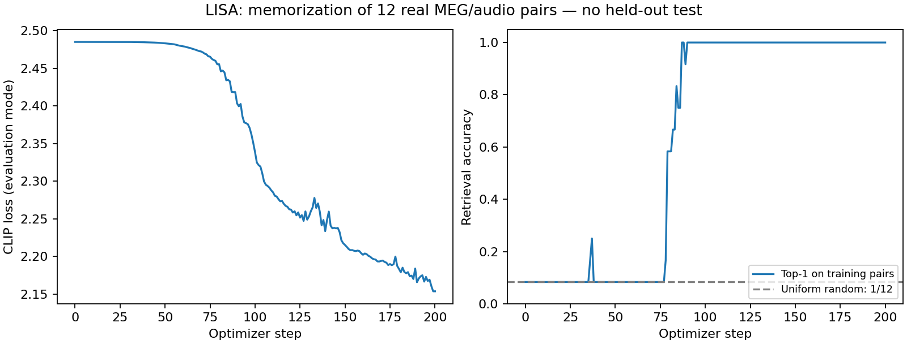

# Первый пилот на исходных данных MEG-MASC

[Каталог](../README.md) · [Код](../../code/scripts/exp03_real_data_pilot/README.md) · [Результаты](results/)

Начало: 2026-09-09. Подготовка и диагностическое обучение завершены 2026-09-10.
Самостоятельная подготовка из публичных исходных файлов.

## Гипотеза

Подготовленные реальные МЭГ/аудио-пары пригодны для вычислений LISA, и модель способна запомнить соответствие 12 обучающих пар: получить Top-1 = 100% на тех же парах и уменьшить loss. Это проверка запоминания; она не устанавливает качество обобщения или правильность временного выравнивания.

## Задачи

1. Получить минимальный набор записи, стимулов и ICA; проверить размеры файлов и контрольные суммы.
2. Подготовить 12 пар МЭГ/аудио, проверить частоту, каналы, формы массивов и конечность значений.
3. Выполнить проверочные шаги обучения и отдельный прогон запоминания на одном и том же наборе пар.
4. Сохранить кривые loss, ранги, checkpoint и характеристики ресурсов; проверить повторную загрузку checkpoint.

## Скрипты

Все пути ниже указаны от корня репозитория.

| Путь | Назначение |
|---|---|
| [code/scripts/exp03_real_data_pilot/inspect_pilot_files.py](../../code/scripts/exp03_real_data_pilot/inspect_pilot_files.py) | Инвентаризация исходных файлов OSF. |
| [code/scripts/exp03_real_data_pilot/download_pilot.py](../../code/scripts/exp03_real_data_pilot/download_pilot.py) | Загрузка и проверка минимального набора. |
| [code/scripts/exp03_real_data_pilot/prepare_pilot.py](../../code/scripts/exp03_real_data_pilot/prepare_pilot.py) | Подготовка пар и проверка вычислительного пайплайна. |
| [code/scripts/exp03_real_data_pilot/overfit_pilot.py](../../code/scripts/exp03_real_data_pilot/overfit_pilot.py) | Диагностика запоминания 12 пар. |

## Выбранные входы

Первый испытуемый (`sub-01`), сессия `ses-0`, история `task-0` (`lw1`). Скачаны 15 файлов общим объёмом 215 032 634 байта: исходная запись, BIDS-метаданные, маркеры, геометрия головы, события, ICA-решение и первый аудиофрагмент с текстом. Полный датасет не скачивался.

Исходная запись содержит 396 секунд, 208 МЭГ-каналов при 1000 Гц и 3134 аннотации. Начало `lw1_0.wav` указано в BIDS-событиях: 23.506 с от начала записи. В аннотации имя имеет историческое окончание `lw1_0.0.wav`; исходный аудиофайл — `lw1_0.wav`, как предусмотрено кодом автора.

Источники:

- [MEG-MASC на OSF](https://osf.io/ag3kj/).
- [ICA-решения автора](https://osf.io/3wrft/).
- [LISA, проверенный commit](https://github.com/ivsemenkov/LISA/tree/c63eb681e306bd56c7f9bb98a4e1a786d1e92dbe).
- [Аудиомодель wav2vec2](https://huggingface.co/facebook/wav2vec2-base-960h/tree/22aad52d435eb6dbaf354bdad9b0da84ce7d6156).

Для каждого из 15 файлов проверены размер и предоставленные OSF хеши; вычислен локальный SHA-256. Точные ссылки и контрольные суммы сохранены в `data/pilot/downloads.json`.

## Обработка

1. Загрузить запись авторским BIDS-загрузчиком, проверить частоту и каналы.
2. Проверить совпадение порядка каналов с ICA, применить отмеченные автором исключаемые компоненты. Очищенный FIF на диск не сохраняется, чтобы не создавать дополнительную большую копию.
3. Авторской функцией снизить частоту до 100 Гц, выполнить baseline correction, RobustScaler, StandardScaler и ограничение выбросов.
4. Выбрать первые 36 секунд первого аудиофрагмента; сформировать 12 неперекрывающихся окон по 3 секунды. МЭГ-окна сдвинуть на +150 мс, сохранив принятую в LISA дискретизацию onset.
5. Получить признаки wav2vec2: среднее четырёх последних скрытых слоёв.
6. Проверить прямой проход и три шага обучения LISA, затем расчёт retrieval на том же батче.

MFA здесь не требуется: границы аудиофрагмента уже заданы событиями. Этот пилот не генерирует словесную разметку TextGrid и не заменяет авторскую подготовку полного датасета.

## Ограничения

- Это проверка процесса подготовки и вычислений. Те же 12 окон используются для обновления параметров и проверки retrieval; оценку нельзя выдавать за baseline или обобщение.
- ICA и нормализация используют информацию полной записи. Пилот не реализует ограниченный бюджет калибровки нового человека.
- Локальные файлы пилота имеют собственную простую структуру, а не полный формат входов стандартного `lisa-train`.
- Веса LISA инициализируются заново; готовые веса декодера у автора не запрашивались. Предобучена только публичная аудиомодель, как в исходном методе.

## Повторение

Из корня проекта:

```bash
.venv/bin/python code/scripts/exp03_real_data_pilot/inspect_pilot_files.py
.venv/bin/python code/scripts/exp03_real_data_pilot/download_pilot.py
```

Официальная аудиомодель должна находиться в `data/pilot/wav2vec2-base-960h/`: `config.json`, `preprocessor_config.json`, `model.safetensors` из указанной выше ревизии.

```bash
.venv/bin/python code/scripts/exp03_real_data_pilot/prepare_pilot.py
.venv/bin/python code/scripts/exp03_real_data_pilot/overfit_pilot.py --steps 200 --seed 42
```

Подготовка работает на CPU. Скачивание требует интернета; после получения исходников и весов подготовка использует только локальные файлы.

## Результаты 2026-09-10

Все 15 исходных файлов повторно проверены по размерам и сохранённым SHA-256.
Подготовка завершилась за 4.45 с внутри скрипта (без времени импорта библиотек):
МЭГ `[12, 208, 300]`, аудио `[12, 48000]`, wav2vec2 `[12, 149, 768]`.
Три массива занимают 10 792 320 байт. Проверены конечность значений, частота,
число каналов и совпадение их порядка с ICA. Исключены компоненты 3, 6, 8, 9, 11.

При загрузке wav2vec2 Transformers сообщает о новой инициализации `masked_spec_embed`.
Этот параметр применяется для маскирования при обучении либо при явной передаче
маски; здесь аудиомодель находится в `eval()`, маска не передаётся. Поэтому он
не используется при извлечении этих эмбеддингов. Авторские функции не изменены.

Отдельная диагностика запоминания начинает с новой LISA, seed 42, CPU, 4 потока,
детерминированные алгоритмы PyTorch. Выполнено ровно 200 шагов AdamW на всех 12
парах: LR модели `3e-4`, LR температуры `1e-3`, weight decay 0, spatial dropout 0.
Все параметры LISA обучаемы; это не адаптация только матрицы нового человека.
После каждого шага метрики считаются в `eval()` на том же банке из 12 кандидатов.
Критерий успеха: итоговый Top-1 = 100% и loss ниже исходного.

| Метрика на обучающих парах | До обучения | После 200 шагов |
|---|---:|---:|
| Top-1 | 1/12 (8.33%) | 12/12 (100%) |
| Top-10 | 10/12 (83.33%) | 12/12 (100%) |
| Средний ранг правильного кандидата (от 1) | 6.5 | 1.0 |
| CLIP loss с обучаемой температурой | 2.484914 | 2.153904 |
| CLIP loss без масштаба температуры | 2.484914 | 2.237463 |

Первый шаг с Top-1 = 100% — 87. Обучение с оценкой после каждого шага заняло
7.97 с; пиковый RSS процесса диагностики — 600 817 664 байта (около 573 МиБ).
Это измерение малого CPU-прогона, оно не включает процесс подготовки и не
экстраполируется на полный датасет. Сохранённый checkpoint повторно загружен:
выход модели совпал с выходом до сохранения точно.



**Вывод:** подготовленные массивы пригодны для вычислений и модель способна
запомнить заданное соответствие 12 пар. Это не проверка обобщения и само по себе
не доказывает правильность временного выравнивания: маленький набор можно
запомнить и с ошибочным соответствием. Top-10 на 12 кандидатах также имеет
высокий случайный уровень — 83.33%.

Следующий эксперимент — небольшой baseline с отдельными train/validation/test
по целым аудиофрагментам. До его запуска нужно расширить набор стимулов,
зафиксировать границы и контекст обработки, обучать нормализацию только на
разрешённых данных и явно описать использование ICA полной записи. Тестовый
банк кандидатов фиксируется заранее; параметры выбираются только по validation.

## Артефакты

- `data/pilot/prepared/meg_windows.npy` — окна МЭГ.
- `data/pilot/prepared/audio_windows_16k.npy` — соответствующие аудиоокна.
- `data/pilot/prepared/audio_embeddings.npy` — цели wav2vec2.
- `data/pilot/prepared/windows.csv` — идентификаторы и точные временные границы.
- `data/pilot/prepared/channels.json` — порядок каналов.
- `experiments/exp03_real_data_pilot/results/real_data_pilot.json` — результат подготовки и трёх шагов обучения.
- `experiments/exp03_real_data_pilot/results/real_data_overfit.json` — конфигурация, метрики и SHA-256 подготовленных файлов для диагностики запоминания.
- `experiments/exp03_real_data_pilot/results/real_data_overfit_history.csv` — loss, Top-1, Top-10 и средний ранг после каждого шага.
- `experiments/exp03_real_data_pilot/results/real_data_overfit_predictions.csv` — предсказание и полный ранг правильного кандидата для каждого окна.
- `experiments/exp03_real_data_pilot/results/real_data_overfit.png` — кривые обучения.
- `data/pilot/overfit_checkpoint.pt` — модель, loss, оптимизатор и конфигурация после 200 шагов (в Git не хранится).
