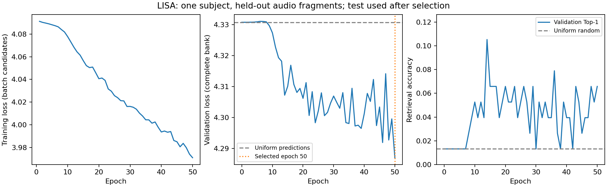

# Эксперимент 04 — небольшой baseline на одном испытуемом

[Каталог](../README.md) · [Код](../../code/scripts/exp04_small_baseline/README.md) · [Протокол](protocol.json) · [Результаты](results/)

Дата: 2026-09-10. Цель — проверить обучение LISA и retrieval на отложенных
аудиофрагментах, измерить вычислительные затраты перед межсубъектным переносом.
Протокол зафиксирован до обучения в [baseline_protocol.json](protocol.json).

## Гипотеза

LISA, обученная на train-фрагментах одного участника, извлекает соответствие МЭГ и речи на отложенных фрагментах тех же историй лучше случайного выбора среди 99 кандидатов. Это within-subject baseline, а не межсубъектный перенос.

## Задачи

1. Зафиксировать данные sub-01/ses-0, целые train/validation/test-фрагменты и неперекрывающиеся окна.
2. Подготовить признаки с train-only нормировкой, проверить целостность разбиений и явно учесть использование ICA полной записи.
3. Обучить модель и выбрать checkpoint только по validation, затем оценить его на фиксированном test-банке из 99 кандидатов.
4. Сохранить Top-1/Top-10, полный ранг, кривые обучения, время и память; подготовить иллюстрацию реальных входов.

## Скрипты

Все пути ниже указаны от корня репозитория.

| Путь | Назначение |
|---|---|
| [code/scripts/exp04_small_baseline/download_baseline.py](../../code/scripts/exp04_small_baseline/download_baseline.py) | Загрузка фиксированного поднабора. |
| [code/scripts/exp04_small_baseline/prepare_baseline.py](../../code/scripts/exp04_small_baseline/prepare_baseline.py) | Окна, разбиения, нормировка и признаки. |
| [code/scripts/exp04_small_baseline/test_baseline.py](../../code/scripts/exp04_small_baseline/test_baseline.py) | Проверки разбиений и полного банка кандидатов. |
| [code/scripts/exp04_small_baseline/train_baseline.py](../../code/scripts/exp04_small_baseline/train_baseline.py) | Обучение, выбор checkpoint и test-оценка. |
| [code/scripts/exp04_small_baseline/plot_meg_example.py](../../code/scripts/exp04_small_baseline/plot_meg_example.py) | Рисунок подготовленной МЭГ/аудио-пары. |

## Данные и разбиение

Испытуемый `sub-01`, сессия `ses-0`, записи `task-0` (`lw1`) и `task-2`
(`easy_money`). Все 43 исходных файла проверены по размерам и контрольным
суммам; манифест — `data/pilot/baseline_downloads.json`. Входы занимают
900 264 333 байта, включая ранее скачанные файлы пилота.

Двенадцать исходных аудиофрагментов содержат 24 мин 6.6 с. От каждого края
отброшена как минимум одна секунда; остатки короче трёх секунд также исключены.
Получилось 469 неперекрывающихся окон, 23 мин 27 с анализируемой речи.

| Часть | Аудиофрагменты | Окна | Длительность окон |
|---|---|---:|---:|
| Train | `lw1_0`, `lw1_1`, `easy_money_0`–`easy_money_4` | 294 | 14 мин 42 с |
| Validation | `lw1_2`, `easy_money_5` | 76 | 3 мин 48 с |
| Test | `lw1_3`, `easy_money_6`, `easy_money_7` | 99 | 4 мин 57 с |

Каждый аудиофрагмент принадлежит ровно одной части. Фрагмент `lw1_0`, который
использовался для диагностики запоминания в exp03, включён только в train.
Границы сырых окон не пересекаются. Истории и человек общие для всех частей:
это оценка новых фрагментов знакомых историй у знакомого человека, а не LOSO
и не проверка переноса на новую историю.

## Подготовка и ограничения

1. Авторский BIDS-загрузчик читает запись: 208 каналов, 1000 Гц.
2. Применяется авторская ICA с проверкой порядка каналов. Исключённые компоненты:
   `task-0`: 3, 6, 8, 9, 11; `task-2`: 1, 5, 7, 9, 10.
3. Каждый аудиофрагмент вырезается из МЭГ отдельно, с дополнительными 150 мс
   в конце для задержки ответа; после этого выполняется ресемплинг до 100 Гц.
   Его контекст ограничен одним фрагментом и не пересекает границы split.
4. Окна МЭГ сдвинуты на +150 мс относительно аудио. Начало исходного фрагмента
   округляется до ближайшего отсчёта 1000 Гц; это отличается от округления
   абсолютного onset вниз на сетку 100 Гц в exp03, максимум на 9 мс.
5. RobustScaler и StandardScaler обучаются только на 88 200 временных отсчётах
   из 294 train-окон. Для validation/test применяются сохранённые параметры.
   Значения ограничиваются ±20 стандартными отклонениями. Полная запись и
   промежутки между окнами в оценке параметров нормализации не участвуют.
6. wav2vec2 `facebook/wav2vec2-base-960h`, ревизия
   `22aad52d435eb6dbaf354bdad9b0da84ce7d6156`, обрабатывает каждое трёхсекундное
   аудиоокно отдельно в `eval()`. Цель — среднее четырёх последних скрытых слоёв.

**Ограничение ICA:** её авторские параметры оценены по полной записи, включая
отложенные фрагменты. Это использование неразмеченных тестовых данных на этапе
очистки. Здесь проверяется baseline при таком препроцессинге; строгий режим
без доступа к тестовой записи и бюджет калибровки нового человека не заявляются.

Препроцессинг отличается от полной авторской подготовки: независимый ресемплинг
фрагментов, train-only нормализация, окна без перекрытия, отсутствие MFA и
словесных TextGrid. Авторский test из `the_black_willow` здесь не используется.
Сравнивать проценты напрямую с результатами статьи нельзя.

Массивы: МЭГ `[469, 208, 300]`, аудио `[469, 48000]`, признаки `[469, 149, 768]`.
Подготовленные файлы вместе с метаданными занимают 421 848 210 байт.
Подготовка заняла 56.64 с внутри скрипта; пиковый RSS процесса — 8 417 001 472
байта, около 7.84 ГиБ. Большая часть памяти нужна для исходной записи и ICA;
очищенные полные FIF на диск не записываются.

## Обучение и оценка

- Новая LISA из закреплённого upstream commit; веса exp03 не используются.
- CPU, 4 потока, seed 42, детерминированные алгоритмы PyTorch.
- 50 эпох, batch size 64, AdamW: LR модели `3e-4`, LR температуры `1e-3`,
  weight decay 0. Spatial dropout 0; обучаются все параметры модели.
- В train отрицательные кандидаты берутся из текущего батча. В validation
  каждый запрос сравнивается со всеми 76 кандидатами, в test — со всеми 99.
  Разбиение запросов на вычислительные батчи банк кандидатов не меняет.
- Выбирается минимум validation cross entropy с текущей температурой.
  Кандидаты — инициализация (эпоха 0) и все 50 обученных состояний.
- После выбора checkpoint его повторно загружают, проверяют совпадение
  validation-метрик и один раз оценивают test. Настройки по test не меняются.
- Top-1, Top-10 и средний ранг считаются по полному банку; ранг начинается с 1.
  Случайный уровень test: Top-1 = 1/99 = 1.01%, Top-10 = 10/99 = 10.10%,
  ожидаемый средний ранг = 50. Окна зависимы, а тест содержит только три
  фрагмента; итог не является надёжной оценкой вариативности между людьми.

## Повторение

Из корня проекта с установленным окружением и исходным пилотом:

```bash
.venv/bin/python code/scripts/exp04_small_baseline/download_baseline.py
.venv/bin/python code/scripts/exp04_small_baseline/prepare_baseline.py
.venv/bin/python code/scripts/exp04_small_baseline/test_baseline.py
.venv/bin/python code/scripts/exp04_small_baseline/train_baseline.py
```

Скачивание использует сохранённый OSF-инвентарь и проверяет хеши; остальные
этапы работают локально. Подготовка и обучение сверяют контрольные суммы
входов. Повторный запуск записывает артефакты этого же протокола заново;
для нового исследовательского условия нужен отдельный протокол и каталог.

## Артефакты и проверки

- `data/pilot/baseline/`: массивы, `windows.csv`, `fragments.json`, параметры
  нормализации, порядок каналов и копия протокола.
- [baseline_preparation.json](results/baseline_preparation.json): размеры,
  хеши, состав выборок, описание обработки и ресурсы подготовки.
- `data/pilot/baseline_run/best.pt`: выбранные веса, оптимизатор, loss,
  конфигурация и validation-метрики (не хранится в Git).
- [baseline_history.csv](results/baseline_history.csv): история обучения и validation.
- [baseline_result.json](results/baseline_result.json): итоговые метрики и ресурсы.
- [baseline_test_predictions.csv](results/baseline_test_predictions.csv): ранг
  и выбранный кандидат для каждого тестового окна.
- [baseline_training.png](results/baseline_training.png): кривые обучения.

Четыре целевых теста проверяют запрет распределения одного фрагмента между
выборками, запрет пересечения сырых окон, расчёт ранга вне Top-10, независимость
метрик от порядка кандидатов и вычислительного разбиения запросов на батчи.

## Результат

Статус: завершён. Из инициализации и 50 обученных состояний по минимуму
validation loss выбрана эпоха 50. Validation loss снизился с 4.330738 до
4.286970; Top-1 на validation — 5/76 (6.58%), Top-10 — 25/76 (32.89%).
После повторной загрузки checkpoint validation-метрики совпали точно.

| Метрика на test, банк из 99 кандидатов | Модель | Равномерный случайный выбор |
|---|---:|---:|
| Top-1 | 11/99 (11.11%) | 1.01% |
| Top-10 | 26/99 (26.26%) | 10.10% |
| Средний ранг | 33.07 | 50.00 |
| Медианный ранг | 28 | — |

Разбивка по тестовым фрагментам, каждый оценён на общем банке из 99 кандидатов:

| Фрагмент | Окна | Top-1 | Top-10 | Средний ранг |
|---|---:|---:|---:|---:|
| `easy_money_6` | 40 | 7/40 (17.50%) | 13/40 (32.50%) | 27.05 |
| `easy_money_7` | 42 | 3/42 (7.14%) | 9/42 (21.43%) | 34.74 |
| `lw1_3` | 17 | 1/17 (5.88%) | 4/17 (23.53%) | 43.12 |

На train при оценке выбранной модели по полному банку из 294 кандидатов
Top-1 = 19/294 (6.46%), Top-10 = 113/294 (38.44%). Банки train, validation и
test различаются по размеру и составу, поэтому их проценты напрямую не
сопоставляются. Train loss на графике использует кандидатов текущего батча,
а validation loss — фиксированный полный банк из 76 кандидатов.



50 эпох с validation заняли 131.84 с; полный цикл внутри скрипта — 137.49 с,
без времени импорта библиотек. Пиковый RSS обучения — 2 257 534 976 байт
(около 2.10 ГиБ). Данные пилота, расширение, wav2vec2, подготовленные массивы
и оба checkpoint суммарно занимают около 1.72 ГБ на диске; `.venv` не включена.

**Вывод:** на отложенных фрагментах этого испытуемого получены метрики выше
равномерного случайного уровня. Запуск подтверждает работоспособность
baseline с отдельным test. Эффективность межсубъектного переноса, устойчивость
по людям и строгая независимость препроцессинга от test пока не установлены.
Один seed и три тестовых фрагмента не дают основания делать вывод о
статистической значимости или обещать качество на новых испытуемых.

Test использован один раз после выбора весов. Дополнительного подбора
гиперпараметров или эпох после просмотра этого результата не выполнялось.
