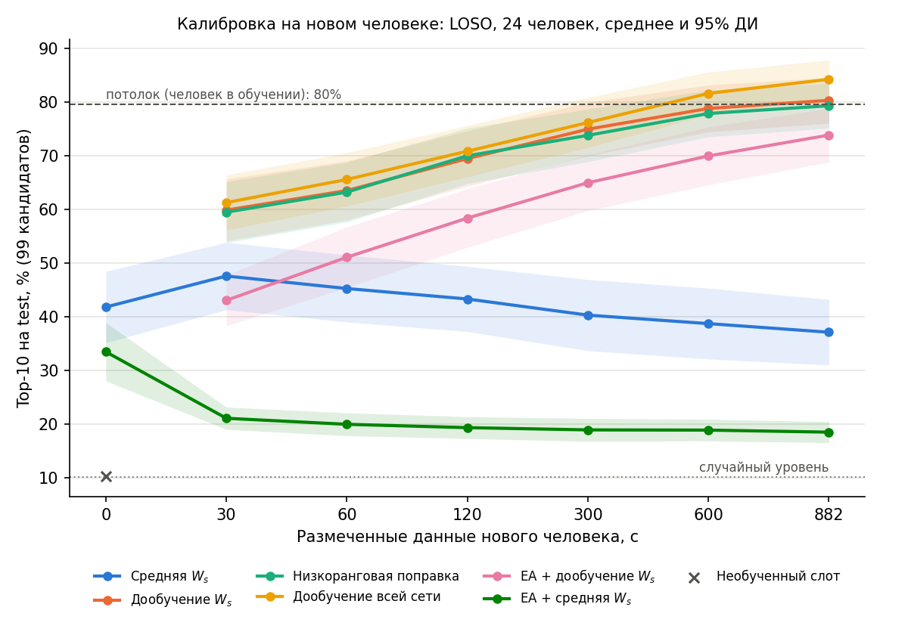

# Эксперимент 06 — LOSO на 27 людях: калибраторы нового человека

[Каталог](../README.md) · [Код](../../code/scripts/exp06_loso/README.md) · [Протокол](protocol.json) · [Результаты](results/)

Дата: 2026-09-17. Масштабирование exp05 с 4 до 27 человек на одной RTX 3090 (vast.ai).
Протокол зафиксирован до обучения: [loso_protocol.json](protocol.json).

## Гипотеза

При нормировке, ограниченной калибровочным бюджетом, дообучение только W_s улучшает перенос на исключённого из обучения участника относительно mean_Ws. Дополнительно проверяется, насколько оно уступает дообучению всей сети и другим калибраторам; отсутствие значимого различия само по себе не доказывает эквивалентность.

## Задачи

1. Подготовить 27 участников с единым разбиением и неизменными test-окнами и банком из 99 кандидатов.
2. Обучить LOSO-модели без отложенного человека по трём сидам, включая shared и shared_ea; отдельно получить ceiling-ориентиры.
3. Подобрать гиперпараметры калибраторов на dev-участниках 1–3 и сравнить методы на участниках 4–27 при бюджетах 0–882 секунды.
4. Агрегировать повторы и сиды внутри человека, рассчитать интервалы и парные сравнения по людям; отдельно выполнить диагностику средней W_s.

## Скрипты

Все пути ниже указаны от корня репозитория.

| Путь | Назначение |
|---|---|
| [code/scripts/exp06_loso/download_loso.py](../../code/scripts/exp06_loso/download_loso.py) | Загрузка участников серии. |
| [code/scripts/exp06_loso/prepare_loso.py](../../code/scripts/exp06_loso/prepare_loso.py) | Подготовка массивов и отчёта целостности. |
| [code/scripts/exp06_loso/train_loso.py](../../code/scripts/exp06_loso/train_loso.py) | Общие модели, подбор и оценка калибраторов. |
| [code/scripts/exp06_loso/run_loso_series.py](../../code/scripts/exp06_loso/run_loso_series.py) | Оркестрация серии. |
| [code/scripts/exp06_loso/summarize_loso.py](../../code/scripts/exp06_loso/summarize_loso.py) | Сводные таблицы, статистика и график. |
| [code/scripts/exp06_loso/diagnose_mean_ws.py](../../code/scripts/exp06_loso/diagnose_mean_ws.py) | Дополнительная диагностика нормировки и средней матрицы. |
| [code/scripts/exp06_loso/mlflow_import_loso_summary.py](../../code/scripts/exp06_loso/mlflow_import_loso_summary.py) | Предпросмотр и отдельная явная публикация агрегатов в MLflow. |

## Уточнение после встречи 5 октября 2026 года

На встрече устное описание разбиения отличалось от реализации. Сверка с
`train_loso.py` подтвердила: test и банк кандидатов неизменны (99/99) при всех
бюджетах, калибровка берётся только из train. У `mean_Ws` не обучается матрица,
но меняется входная нормировка по калибровочным окнам. Dev-людей 3,
оцениваемых holdout-людей 24; исходная модель каждого LOSO-фолда обучена на 26.
Это не постоянный split «24 train / 3 test» и не воспроизведение метрик статьи.
Подробности, ссылки на код и новый план — в [итогах встречи](../../docs/meetings/2026-10-05_semenkov_outcomes.md).

Сырые результаты и исходный JSON-протокол сохранены. При интерпретации выводов
ниже учитывать: отсутствие значимого различия не доказывает равенство методов;
`ceiling` с человеком в обучении не является гарантированной верхней границей;
неудача EA относится к этому пайплайну. Диагностическая поправка нормы средней
Wₛ предложена после просмотра test и требует отдельной проверки. Норма матрицы
не определяет масштаб активаций без учёта ковариации входа.

## Постановка

- **Люди:** все 27 человек MEG-MASC, сессия `ses-0`, истории `lw1` (`task-0`) и `easy_money` (`task-2`).
- **Разбиение:** те же фрагменты, что в exp04/exp05. У каждого человека 294 окна train (882 с), 76 validation и 99 test; окна 3 с.
- **Dev-люди:** `sub-01`…`sub-03`. На них по validation-окнам подбирались lr и число шагов калибраторов (сид 0). В итоговые таблицы они не входят.
- **Оцениваемые люди:** `sub-04`…`sub-27` — 24 фолда LOSO × 3 сида (0, 1, 2).
- **Общая модель (`shared`):**
  - LISA `c63eb68`, обучена на 26 людях без отложенного;
  - AdamW, lr 3e-4, batch 64;
  - early stopping по validation loss обучающих людей, patience 15, максимум 150 эпох.
- **`shared_ea`:** то же, но каждый человек выровнен Euclidean Alignment по своим train-окнам.
- **Потолок (`ceiling`):** одна модель на сид, обучена на всех 27 людях.
- **Нормировка отложенного человека (строгая, основная):**
  - RobustScaler + StandardScaler обучаются **только на окнах бюджета**;
  - при 0 с используется медиана scaler'ов людей из обучения;
  - `pool_*` — вариант exp05: scaler по всему пулу отложенного человека.
- **Бюджеты:**
  - 0 / 30 / 60 / 120 / 300 / 600 / 882 с;
  - для бюджетов меньше полного — 3 случайных непрерывных блока из упорядоченного по времени пула;
  - при 882 с — весь пул.
- **Калибраторы:**

| Код | Что обучается | Подобрано на dev (lr; шаги для 30 / 120 / 600 с) |
|---|---|---|
| `mean_Ws` | ничего, среднее $W_s$ людей из обучения | — |
| `ft_Ws` | матрица $W_s$ 25×270 от средней | 1e-3; 50 / 25 / 50 |
| `ft_lowrank` | $W_s = \bar W + UV$, rank 8 | 3e-4; 400 / 200 / 400 |
| `ft_all` | вся сеть + $W_s$ от средней | 1e-4; 50 / 50 / 200 |
| `ea_mean_Ws`, `ea_ft_Ws` | модель `shared_ea`, выравнивание по окнам бюджета | 3e-3; 10 / 10 / 25 |

  Бюджеты 60 и 300 с берут шаги от 30 и 120 с, бюджет 882 с — от 600 с. Температура и статистики BatchNorm при калибровке заморожены.
- **Оценка:** 99 test-окон отложенного человека против банка из 99 test-аудио-окон.
- **Усреднение:** сначала по повторам, затем по сидам внутри человека. Интервалы — 95% t-интервалы по 24 людям, сравнения — парный Wilcoxon с поправкой Холма на 37 сравнений.

## Результаты



**Top-10 на test, %, среднее ± 95% ДИ по 24 людям.** Случайный уровень — 10.1%.

| Калибратор | 0 с | 30 с | 60 с | 120 с | 300 с | 600 с | 882 с |
|---|---:|---:|---:|---:|---:|---:|---:|
| Необученный слот | 10.2 ± 0.8 | | | | | | |
| Средняя $W_s$ | 41.8 ± 6.6 | 47.5 ± 6.3 | 45.2 ± 6.2 | 43.3 ± 6.1 | 40.3 ± 6.6 | 38.7 ± 6.6 | 37.1 ± 6.1 |
| Дообучение $W_s$ | | 59.8 ± 5.8 | 63.5 ± 5.5 | 69.4 ± 5.2 | 74.9 ± 5.0 | 78.8 ± 4.4 | 80.3 ± 4.3 |
| Низкоранговая поправка | | 59.5 ± 5.7 | 63.2 ± 5.6 | 70.0 ± 5.2 | 73.8 ± 4.9 | 77.9 ± 4.4 | 79.3 ± 4.2 |
| Дообучение всей сети | | 61.2 ± 5.1 | 65.5 ± 5.0 | 70.8 ± 4.8 | 76.2 ± 4.7 | 81.6 ± 4.0 | **84.2 ± 3.6** |
| EA + средняя $W_s$ | 33.4 ± 5.4 | 21.0 ± 2.1 | 19.9 ± 2.1 | 19.3 ± 2.0 | 18.9 ± 2.1 | 18.8 ± 2.0 | 18.4 ± 2.0 |
| EA + дообучение $W_s$ | | 43.0 ± 4.7 | 51.0 ± 5.6 | 58.3 ± 5.5 | 64.9 ± 5.2 | 69.9 ± 5.4 | 73.8 ± 5.0 |
| Дообучение $W_s$, scaler по пулу | | 61.0 ± 5.9 | 64.8 ± 5.7 | 70.8 ± 5.3 | 75.7 ± 5.0 | 79.2 ± 4.4 | 80.4 ± 4.2 |
| Потолок (человек в обучении) | 79.5 (все 882 с, вся сеть) | | | | | | |

**Top-1, %:**

| Калибратор | 30 с | 120 с | 300 с | 882 с |
|---|---:|---:|---:|---:|
| Дообучение $W_s$ | 21.4 | 29.1 | 34.3 | 39.7 |
| Дообучение всей сети | 22.3 | 30.8 | 35.5 | 45.7 |

Случайный уровень Top-1 — 1%. Средние ранги лежат в [`results/summary.csv`](results/summary.csv).

**Парные сравнения (Top-10, п.п., p по Холму):**

| Сравнение | 30 с | 120 с | 300 с | 882 с |
|---|---|---|---|---|
| Дообучение $W_s$ − средняя $W_s$ | +12.3 (23/24 лучше, p<0.001) | +26.2 (24/24) | +34.7 (24/24) | +43.2 (24/24) |
| Вся сеть − $W_s$ | +1.4 (p=0.30) | +1.4 (p=0.06) | +1.2 (p=0.04) | +3.9 (22/24, p<0.001) |
| Низкоранговая − $W_s$ | −0.4 (p=1) | +0.5 (p=0.70) | −1.2 (p=0.25) | −1.0 (p=0.59) |
| EA + $W_s$ − $W_s$ | −16.8 (0/24, p<0.001) | −11.1 | −10.0 | −6.5 |
| Scaler по пулу − строгий | +1.1 (p=0.25) | +1.4 (p=0.02) | +0.8 (p=0.16) | +0.1 (p=1) |

Полная таблица: [`results/comparisons.csv`](results/comparisons.csv).

**Модели** (среднее по всем обученным):

| Модель | Лучшая эпоха | Время, с | Top-10 на test людей из обучения |
|---|---:|---:|---:|
| `shared` (26 человек) | 24 | 189 | 78.1% |
| `shared_ea` | 17 | 157 | 66.5% |
| `ceiling` (27 человек) | 24 | 220 | 79.0% |

Время указано при 4 параллельных процессах на одной GPU. Вся серия — 232 задачи, около 3.5 часа.

## Выводы

1. **Средняя $W_s$ даёт нулевой перенос:** 42% Top-10 без данных нового человека, вчетверо выше случайного уровня и необученного слота.
2. **Дообучение одной матрицы 25×270 — главный калибратор.**
   - Уже 30 с размеченных данных дают +12 п.п. к средней, лучше у 23 из 24 человек.
   - Результат растёт с бюджетом.
   - На полном пуле (882 с) он равен потолку: 80.3% против 79.5%. Отдельная матрица, обученная поверх замороженной сети, заменяет участие человека в обучении.
3. **Дообучение всей сети** стабильно чуть лучше: +1–4 п.п. Значимо при 300 с и больше; на полном пуле превышает потолок (84%). Цена — все 487 тыс. параметров вместо 6.75 тыс.
4. **Низкоранговая поправка** (rank 8, 2.4 тыс. параметров) не отличается от полной матрицы ни при каком бюджете. На этих бюджетах регуляризация рангом не помогает.
5. **Euclidean Alignment в LISA вредит.**
   - Модели с EA хуже уже на людях из обучения: 66% против 78%.
   - Калибровка поверх них отстаёт на 6–17 п.п. у всех бюджетов.
   - Средняя $W_s$ после выравнивания почти не работает.
   - Вероятная причина: пространственное внимание LISA опирается на расположение сенсоров, а whitening перемешивает каналы.
6. **Строгая нормировка почти ничего не стоит:** scaler, обученный только на окнах бюджета, отстаёт от scaler'а по всему пулу не больше чем на 1.4 п.п.
7. **Рост числа людей в обучении с 3 до 26 резко улучшает перенос:** при 30 с Top-10 60% против 33% в exp05 (там был один отложенный человек).

## Диагностика: почему средняя $W_s$ ухудшается с ростом бюджета

Средняя $W_s$ при строгой нормировке падает с 48% (30 с) до 37% (882 с). Проверка — [`code/scripts/exp06_loso/diagnose_mean_ws.py`](../../code/scripts/exp06_loso/diagnose_mean_ws.py), модели сида 0, 24 человека, 20 случайных 30-с блоков на человека; результаты в [`results/diagnose_mean_ws.csv`](results/diagnose_mean_ws.csv).

- **Матрицы людей почти ортогональны.** Средний косинус между $W_s$ разных людей 0.03, поэтому при усреднении они гасят друг друга. Норма средней — 0.98, средняя норма матрицы источника — 3.71. Сигнал после subject-слоя примерно в 3.8 раза слабее того, на котором обучалась сеть.
- **Scaler на коротком блоке занижает масштаб каналов:** медиана 0.70 от масштаба по пулу. Вход усиливается и частично компенсирует слабую матрицу. Внутри человека Top-10 коррелирует с отношением масштабов: r = −0.89.
- **Работает масштаб, а не смещение:**
  - смещение из блока с масштабом из пула — 35.5%, как scaler по пулу (35.6%);
  - масштаб из блока со смещением из пула — 45.3%, как scaler из блока (45.5%).
  - Scaler на самих test-окнах даёт 39.8%, то есть дело не в совпадении распределений.
- **Если восстановить норму средней** (масштабировать до средней нормы матриц источников; данных нового человека не нужно), Top-10 растёт:
  - с 40.0% до 50.6% при population-scaler;
  - с 35.6% до 51.9% при scaler'е по пулу.

Итог: тренд «больше данных для нормировки — хуже» — артефакт нормы средней матрицы, а не свойство данных. Нулевой перенос в таблице выше (и в exp05) занижен. Правило восстановления нормы предложено после просмотра test, поэтому его нужно проверить отдельно: подобрать множитель на dev-людях по validation и добавить как калибратор. На дообучение $W_s$ это не влияет: норма восстанавливается за первые шаги.

## Ограничения

- **Test из тех же историй.** Test-фрагменты взяты из тех же двух историй, что и обучение; перенос на новую историю не проверялся.
- **Малый объём данных.** Одна сессия и две истории на человека. Банк из 99 кандидатов и выровненные окна: проценты нельзя сравнивать с MEG-MASC из статьи LISA.
- **Подбор на троих.** Гиперпараметры калибровки подобраны на 3 dev-людях. Число шагов для 60, 300 и 882 с перенесено с соседнего бюджета.
- **Потолок — не калибратор.** Это одна модель на все фолды, и она использует все данные человека при обучении всей сети.
- **Недетерминированность GPU.** Прогоны не бит-в-бит воспроизводимы (cuDNN benchmark); сиды фиксированы.
- **Выбор модели по validation-loss.** Early stopping по validation loss выбирает эпоху около 24. Модель к этому моменту уже сильно переобучается по train loss, поэтому другие схемы регуляризации могут дать больше.

## Повторение

```bash
# из корня репозитория
.venv/bin/python code/scripts/exp06_loso/download_loso.py             # 27 человек, 22.9 ГБ, хеши проверяются
.venv/bin/python code/scripts/exp06_loso/prepare_loso.py --workers 10 # ~6 мин, 6.5 ГБ массивов
.venv/bin/python code/scripts/exp06_loso/run_loso_series.py --procs 4 # 232 задачи, ~3.5 ч на RTX 3090
.venv/bin/python code/scripts/exp06_loso/summarize_loso.py
.venv/bin/python code/scripts/exp06_loso/diagnose_mean_ws.py          # диагностика средней W_s
```

Оркестратор пропускает готовые задачи, так что после прерывания его можно просто запустить снова.

## Артефакты

- `results/loso_preparation.json` — подготовка, хеши, ICA, сверка с exp05: МЭГ до 1.2e-7, аудио-эмбеддинги до 1.2e-3 (CPU x86 против ARM).
- `results/tuning`, `results/tuning.json` — подбор на dev-людях и выбранные параметры.
- `results/models` — по каждой модели: история обучения, выбранная эпоха, test людей из обучения.
- `results/calibration` — сырые результаты по фолдам и сидам.
- `results/summary.csv`, `per_subject.csv`, `comparisons.csv`, `models.csv` — сводные таблицы.
- `results/loso_calibration_curves.png` — рисунок.
- `data/pilot/loso/`, `data/pilot/loso_runs/` — массивы и checkpoint (не в Git; checkpoint скопированы на ноутбук, 1 ГБ).
